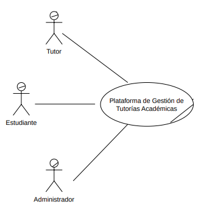

# Core del Negocio — Caso de Uso de Alto Nivel

EduConnect es una plataforma web centralizada para la gestión integral de tutorías académicas que conecta a estudiantes, tutores y administradores en un entorno digital seguro e intuitivo. El núcleo del sistema integra la programación inteligente de sesiones con validación en tiempo real para prevenir traslapes de horarios, un motor de búsqueda avanzada de tutores mediante filtros multidimensionales, la trazabilidad del ciclo de vida de las tutorías con registro de resúmenes académicos, y una capa de supervisión administrativa respaldada por autenticación de doble factor (2FA), notificaciones automatizadas por correo electrónico y generación de reportes analíticos para la toma de decisiones estratégicas.

# Tabla de Actores

| Actor | Por que es un actor |
|-------|-------------------|
| Estudiante | Rol externo que se registra, busca tutores, programa/cancela sesiones y gestiona su perfil (RF-1-1, RF-4-x). Interactúa directamente con el sistema persiguiendo un objetivo propio (agendar tutorías). |
| Tutor | 	Rol externo que se registra, publica horarios, atiende/cancela sesiones y gestiona su perfil (RF-1-2, RF-3-x). Objetivo propio: administrar su agenda académica. |
| Administrador | Rol externo que aprueba/rechaza/da de baja usuarios y consulta reportes (RF-2-x). Tiene un flujo de autenticación propio (2FA) que lo distingue claramente de los otros dos. |

### Diagrama de core

