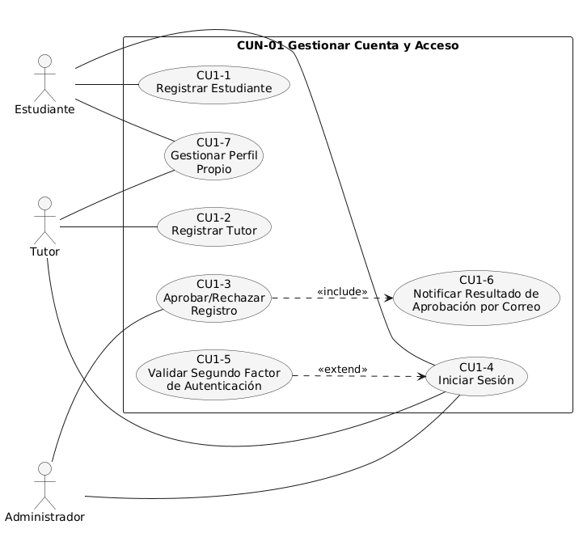
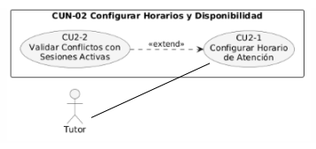
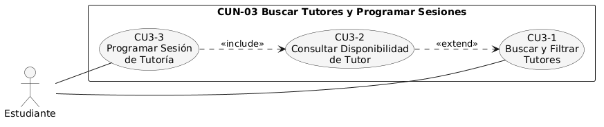
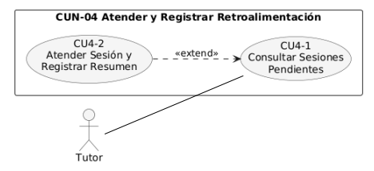
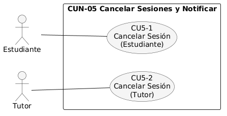
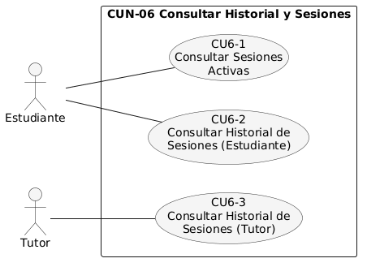
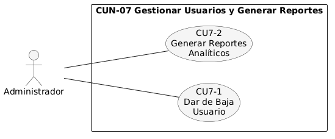

# Diagramas de casos de uso expandidos

**Descripción**

Los diagramas de esta sección expanden cada uno de los siete procesos de negocio (CUN) identificados en la primera descomposición, mostrando los casos de uso puntuales que los conforman, los actores que los ejecutan y las relaciones `<<include>>`/`<<extend>>` existentes entre ellos. Este nivel de detalle permite observar las interacciones específicas entre los actores y el sistema dentro de cada módulo funcional.

## Expansión — CUN-01 Gestionar Cuenta y Acceso

**Descripción**

Este diagrama detalla el proceso de gestión de cuenta y acceso, abarcando el registro de estudiantes y tutores, la aprobación o rechazo de dichas solicitudes por parte del administrador, el inicio de sesión con su respectiva notificación por correo, la validación del segundo factor de autenticación exclusiva del administrador, y la gestión del perfil propio de cada usuario.

## Expansión — CUN-02 Configurar Horarios y Disponibilidad

**Descripción**

Este diagrama representa el proceso mediante el cual el tutor define o modifica sus días y franjas horarias de atención. Incluye la validación de conflictos con sesiones activas, la cual se ejecuta únicamente cuando se trata de una modificación sobre un horario ya existente.

## Expansión — CUN-03 Buscar Tutores y Programar Sesiones

**Descripción**

Este diagrama muestra el flujo mediante el cual el estudiante localiza tutores según distintos criterios de búsqueda, consulta su disponibilidad horaria y, finalmente, programa una sesión de tutoría, validando en el proceso que no existan traslapes ni sesiones activas duplicadas con el mismo tutor.

## Expansión — CUN-04 Atender y Registrar Retroalimentación

**Descripción**

Este diagrama describe la interacción del tutor con las sesiones que tiene pendientes, incluyendo la consulta ordenada de dicha lista y la posibilidad de atender una sesión específica registrando el resumen correspondiente, lo que cierra formalmente el ciclo de la tutoría.

## Expansión — CUN-05 Cancelar Sesiones y Notificar

**Descripción**

Este diagrama presenta los dos flujos independientes de cancelación de una sesión de tutoría: el que ejecuta el estudiante y el que ejecuta el tutor, este último acompañado de la notificación automática por correo al estudiante afectado.

## Expansión — CUN-06 Consultar Historial y Sesiones

**Descripción**

Este diagrama agrupa las consultas de seguimiento académico disponibles para estudiantes y tutores: las sesiones activas del estudiante y los historiales de sesiones atendidas o canceladas, tanto del estudiante como del tutor.

## Expansión — CUN-07 Gestionar Usuarios y Generar Reportes

**Descripción**

Este diagrama corresponde a las funciones de control administrativo de la plataforma: dar de baja a estudiantes o tutores aprobados que incumplan las políticas institucionales, y generar reportes analíticos en tiempo real sobre el uso del sistema.

