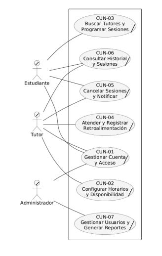

# Primera Descomposicion del Core

## Diagrama de la primera descomposición

**Descripción**

La primera descomposición divide el Caso de Uso Core en los siete procesos de negocio (CUN) que conforman la gestión de tutorías académicas. En este nivel se identifican los actores participantes y las áreas funcionales del sistema (cuenta y acceso, horarios, búsqueda y programación, atención de sesiones, cancelaciones, historial y administración), sirviendo como preparación para el desglose detallado de cada proceso.

