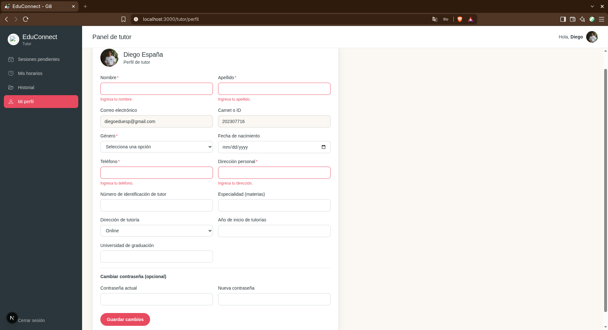
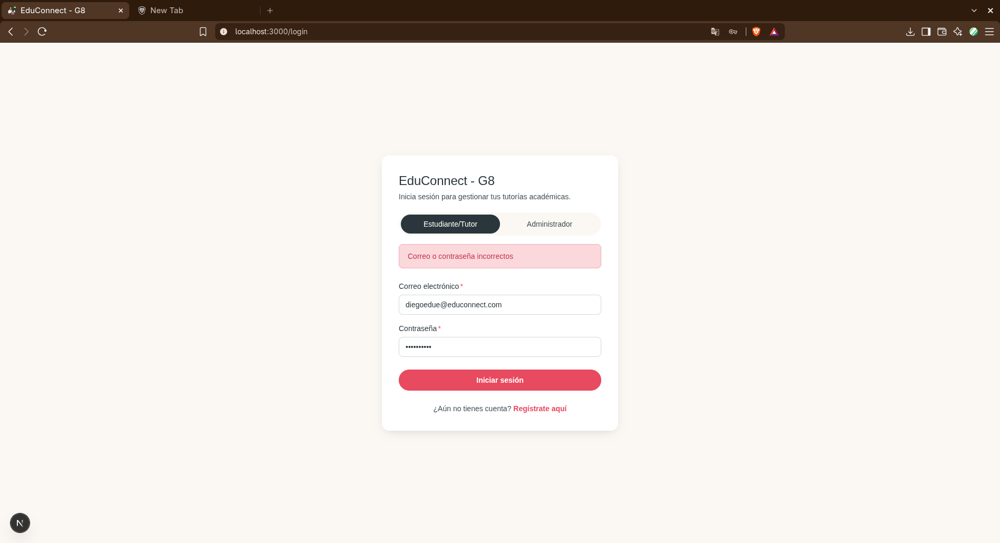
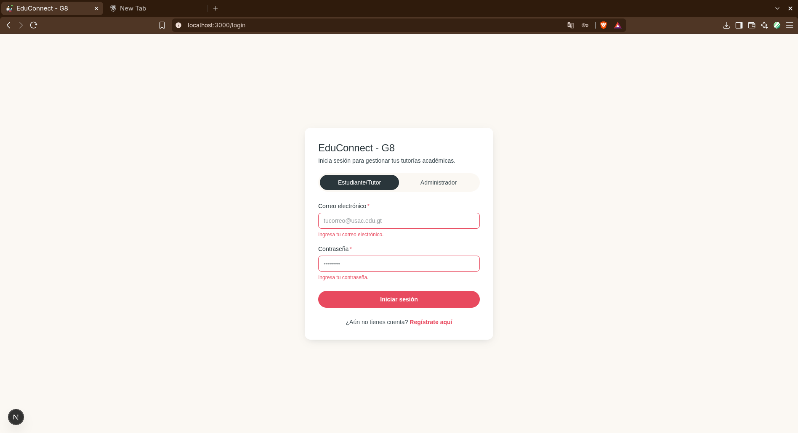
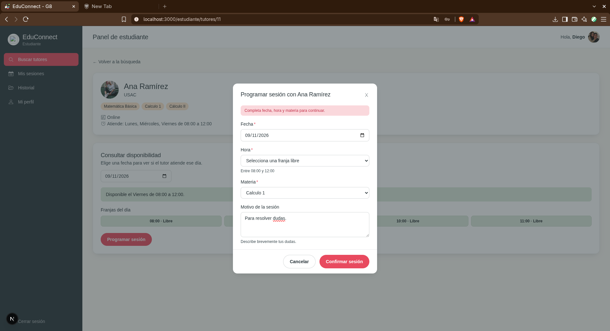

# Manual UI/UX - EduConnect

##  1. Principios heurísticos de Jakob Nielsen
Los principios utilizados en el proyecto serán descritos a continuación:

**1. Visibilidad del estado del sistema:** En la parte superior aparece una notificación que indica si la acción fue éxitosa o hay un error. En el caso de rechazo de un usuario aparece una notificación de warning, porque es una acción que ya no tiene retorno.

**2. Coincidencia entre el sistema y el mundo real:** Se utiliza lenguaje natural a lo largo de todo el proyecto para que el usuario sepa a donde se tiene que dirigir. Todo sin necesidad de ayuda.

**3. Control y libertad del usuario:**
En cada sección el usuario es libre de cancelar la acción y volver atrás.

**4. Consistenia y estándares:** A lo largo del proyecto se utilizó una paleta de colores consistente y agradable para la vista. Además de iconos que brindan la suficiente información con tan solo observarlos.

**5. Prevención de errores:** El sistema pide una confirmación antes de realizar acciones destructivas.

**6. Reconocimiento antes que memorización:** Los menús y opciones son visibles y accesibles, ya que permiten al usuario reconocer funciones rápidamente.

**7. Diseño estético y minimalista:** Se brinda la informacción visual necesaria, para que el usuario se sienta a gusto con el sistema.

**8. Ayuda al usuario a reconocer, diagnosticar y recuperarse de errores:** Los mensajes de error son claros y se muestran en color rojo.

## 2. Guía de estilos

### 2.1 Paleta de colores

#### Colores utilizados

| Nombre | Uso | HEX |
|---|---|---|
| Emerald Ink (`brand`) | Color primario. Acciones principales, navegación activa, logotipo, enlaces | `#064E3B` |
| Emerald Ink · dark (`brand-dark`) | Hover de botones primarios | `#043829` |
| Emerald Ink · light (`brand-light`) | Acentos suaves sobre fondos oscuros | `#0B6E54` |
| Champagne (`champagne`) | Chips, etiquetas, fondos de destacados | `#F8E7C9` |
| Champagne · dark (`champagne-dark`) | Borde de chips, estrellas rellenas | `#EBD3A3` |
| Champagne · light (`champagne-light`) | Fondos muy suaves | `#FBF1DE` |
| `surface` (blanco) | Fondo de tarjetas y modales | `#FFFFFF` |
| `surface-alt` | Fondo general de la app | `#F6F2E8` |
| `surface-sunken` | Paneles secundarios, talón del ticket | `#EFE8D6` |
| `ink` | Texto principal | `#16231D` |
| `ink-dim` | Texto secundario | `#5B6B62` |
| `ink-faint` | Texto terciario, placeholders | `#8C978F` |
| `border` | Bordes y divisores | `#E1D8BF` |
| Éxito | `#0B6E54` | `#E4F3EC` |
| Error / peligro | `#A8442E` | `#F7E7E2` |
| Advertencia | `#B5842A` | `#FBF0DA` |
| Información | `#064E3B` | `#F8E7C9` |

---

### 2.2 Tipografía

| Familia | Uso | 
|---|---|
| **Bebas Neue**  | Títulos de gran tamaño, números destacados |
| **Inter**  | Todo el texto de interfaz: párrafos, labels, botones, navegación |
| **JetBrains Mono** | Datos técnicos puntuales |

---

### 2.3 Logotipo

El logotipo de CineCraft son los poporopos de maíz ilustrados, en dos versiones:

| Versión | Cuándo usarla |
|---|---|
| **Contorno (sin color)**  | Junto al texto "CineCraft" en el Sidebar y cualquier lugar sobre fondo claro de la app |
| **A color** | Únicamente como favicon / ícono de pestaña del navegador |

---

### 2.4 Iconografía e imágenes

#### Estilo de los íconos

- **Tipo:** lineales minimalistas — nunca íconos rellenos sólidos  salvo excepciones puntuales marcadas abajo.
- **Grosor de trazo:** 1px por defecto.
- **Lienzo:** `0 0 24 24` en todos los íconos, para que cualquier ícono nuevo sea intercambiable con los existentes sin desalinear nada.
- **Color:** siempre `currentColor` — así el ícono hereda el color de texto del contenedor  y respeta la paleta automáticamente en cualquier estado.
- **Excepciones con relleno:** la estrella de calificación y el corazón de favoritos  tienen un prop `filled` que cambia de contorno a relleno sólido para representar el estado "activo" (calificado / marcado como favorito). Es la única razón válida para rellenar un ícono.
