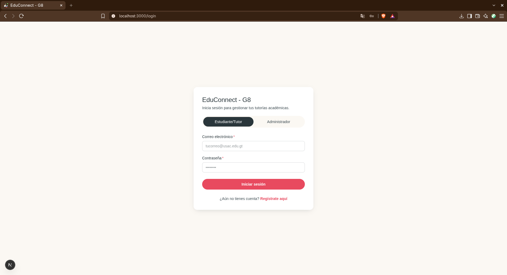
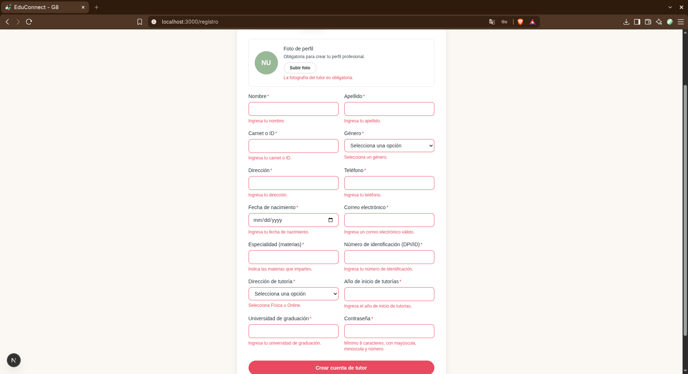
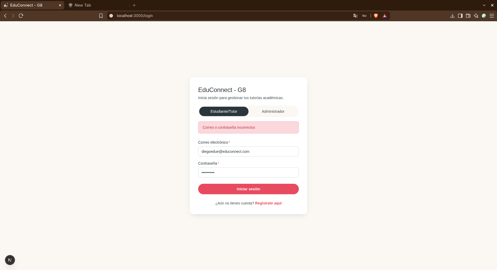
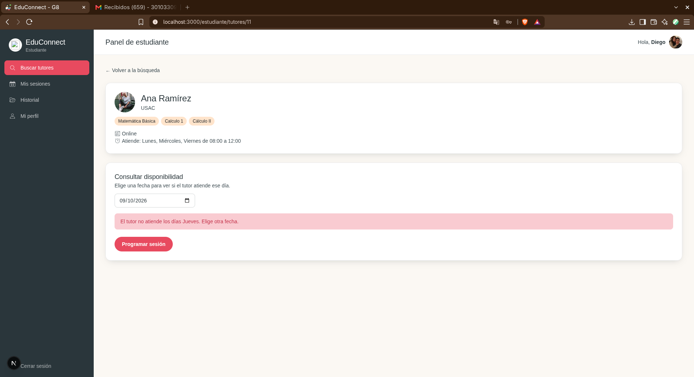
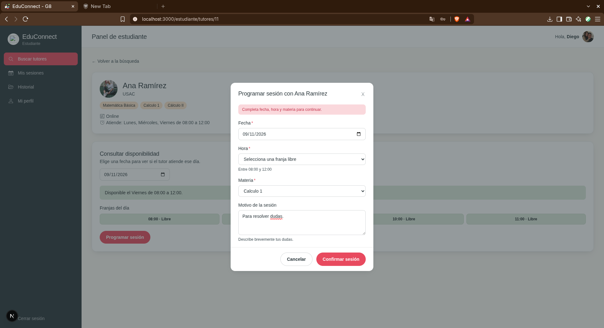
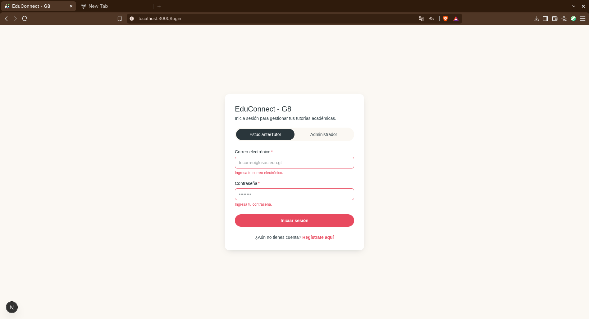
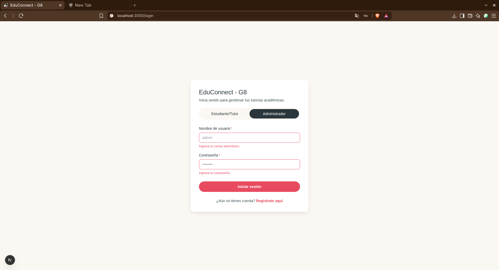

# Manual de usuario - EduConnect

---

## 1. Introducción

CineCraft es una aplicación web para gestionar reseñas de películas, organizar opiniones por categoría, compartir contenido con otros usuarios y revisar solicitudes de acceso para administradores.

La interfaz está pensada para dos perfiles principales:

- Usuario normal: crea, edita, elimina, destaca y comparte reseñas.
- Administrador: revisa solicitudes de registro, aprueba o rechaza nuevos usuarios, consulta reportes e historial.

---

## 2. Requisitos y acceso

### Requisitos mínimos

- Navegador web moderno: Chrome, Edge, Brave.
- Conexión a Internet para cargar la aplicación.
- Dirección de correo válida.

### Acceso inicial
1. En el navegador ponga la dirección **http://localhost:3000**.
2. En la pantalla de rediccionará al login para acceder al dashboard.
3. Ingrese su correo electrónico institucional y contraseña.
4. El sistema dirigirá automáticamente al usuario según su rol:
   - Usuario normal: a la sección de reseñas.
   - Administrador: a la sección de solicitudes.

---

## 3. Registro y autenticación

### Solicitar acceso

1. En la pantalla de login, haga clic en "Solicita tu registro".

2. Complete el formulario con:
   - Nombre completo
   - Correo electrónico
   - Contraseña (mínimo 8 caracteres)
   - Confirmación de la contraseña
3. Envíe la solicitud.

4. El sistema mostrará un mensaje confirmando que la solicitud fue enviada y quedará pendiente de revisión.

### Inicio de sesión

- El usuario debe usar el correo asociado a la cuenta autorizada.

- Si el correo incluye la palabra "admin", el sistema identifica al perfil como administrador.

- Si las credenciales no coinciden, la aplicación muestra un mensaje de error y no permite continuar. (Sección de errores)

---

## 4. Panel de usuario

Una vez iniciada la sesión, el usuario accede a un panel con navegación lateral y cabecera superior.

### Menú principal del usuario

- Dashboard: vista principal con todas las reseñas activas.

- Compartidas: reseñas compartidas contigo y por ti.

- Mi perfil: configuración básica del perfil.

- Cerrar sesión: termina la sesión actual.

---

## 5. Gestión de reseñas

### Crear una reseña

1. En la vista "Mis reseñas", haga clic en cualquiera de los dos botones que dicen "Nueva reseña".

2. Complete la información:
   - Título de la película: Este campo es obligatorio.
   - Calificación: Elegir una calificación de 1 a 5 estrellas presionando sobre ellas.
   - Género: Para elegir una se debe eliminar la que está por defecto y se desplegarán las opciones. Si se desea agregar una nueva, basta con escribir el nuevo género.
   - Comentario: Puede ser una reseña larga o breve.

3. Guarde la reseña.
4. La nueva reseña aparece en la lista principal.

### Ver reseñas

La vista principal muestra las reseñas activas, con las siguientes opciones:

- Filtro "Todas"
- Filtro "Destacadas"
- Filtro "Archivadas"

Cada tarjeta muestra:

- Título de la película
- Calificación
- Etiqueta
- Comentario
- Acciones rápidas de edición, archivado, destacado y eliminación

Código de color:
Es importante saber que la cantidad de estrellas está asociado a un código de color.

- 1-2 estrellas: Rojo
- 3-4 estrellas: Amarillo
- 5 estrellas: Verde

**Todas**

### Destacar una reseña

1. Abra la reseña deseada.
2. Use el botón de favorito o destacado.
3. La reseña pasa a la sección de "Destacadas".

### Archivar una reseña

1. Seleccione la reseña.
2. Active la opción de archivar.
3. La reseña deja de mostrarse en el dashboard principal y aparece en "Archivadas".

### Editar una reseña

1. Haga clic en la opción de edición de la reseña.
2. Modifique los campos requeridos.
3. Guarde los cambios.

### Eliminar una reseña

1. Acceda a la acción de eliminación.
2. Confirme la acción en el diálogo de confirmación.
3. La reseña se elimina de forma permanente del listado.

---

## 6. Compartir reseñas

### Compartir con otro usuario

1. Seleccione la reseña a compartir.
2. Use la opción de compartir.
3. Ingrese el correo del destinatario.
4. Envíe la solicitud de compartición.

### Ver reseñas compartidas

En la sección "Compartidas" puede consultar:

- Compartidas conmigo: reseñas enviadas por otros usuarios.

- Compartidas por mí: reseñas que tú enviaste a otros.

---

## 7. Perfil del usuario

En "Mi perfil" puede:

- Actualizar el nombre completo.
- Revisar el correo asociado a la cuenta y editarlo.
- Guardar cambios si se modifica el nombre.

Se valida que el nombre y el correo no quede vacío antes de guardar.

---

## 8. Panel de administrador

### Menú principal del administrador

- Solicitudes
- Historial
- Reportes

### Solicitudes de registro

El administrador puede:

- Revisar la lista de usuarios pendientes.
- Aprobar solicitud: admite al usuario a la plataforma.
- Rechazar solicitud: solicita un motivo opcional y descarta la solicitud.

### Historial

La vista de historial muestra todas las solicitudes ya procesadas, separadas por:

- Todas

- Aprobadas

- Rechazadas

También se muestra el motivo del rechazo cuando aplica.

### Reportes

La sección de reportes muestra:

- Top 5 de usuarios con más reseñas.
- Top 5 de usuarios con más reseñas compartidas.

---

## 9. Recomendaciones de uso

- Mantenga un nombre claro para cada reseña para facilitar la búsqueda.
- Use etiquetas consistentes para organizar los géneros.
- Archive reseñas antiguas cuando ya no formen parte del dashboard activo.
- Verifique el correo del destinatario antes de compartir una reseña.
- Revise periódicamente las solicitudes pendientes si es administrador.

---

## 10. Solución de errores cómunes

### No puedo iniciar sesión

- Verifique que el correo y la contraseña sean correctos.
- Confirme que la cuenta haya sido aprobada por un administrador.

### No veo mis reseñas

- Confirme que la reseña no esté archivada.
- Actualice la página si la vista tarda en cargar.
- Verifique la conexión a Internet.

### La solicitud de registro no fue aceptada

- Puede haber sido rechazada por un administrador.
- Revise el motivo si estuvo disponible en el historial del administrador.

### No se puede compartir una reseña

- Revisar que el correo del destinatario sea válido.
- Asegurarse que el otro usuario tenga acceso a "Cinecraft".

### Edición de perfil

- Asegurarse de llenar los campos.

### Registro

- Asegurarse de llenar todos los campos.
- Ingresar una dirección de correo válida.
- Ingresar una contraseña de 8 carácteres de longitud y asegurarse de agregar al menos un número.
- Asegurarse que ambas contraseñas sean iguales.

