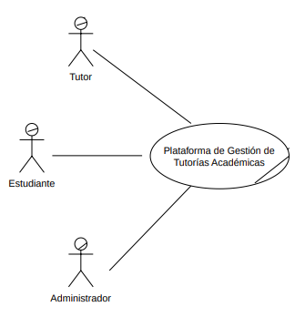

# Core del Negocio — Caso de Uso de Alto Nivel

EduConnect es una plataforma web centralizada para la gestión integral de tutorías académicas que conecta a estudiantes, tutores y administradores en un entorno digital seguro e intuitivo. El núcleo del sistema integra el registro de usuarios con verificación de correo mediante token y aprobación administrativa sustentada en la revisión de sus documentos PDF, la programación de sesiones con validación para prevenir traslapes de horarios, un motor de búsqueda avanzada de tutores mediante filtros multidimensionales, y la trazabilidad del ciclo de vida de las tutorías, que abarca la atención con un plan de estudio estructurado (dificultades identificadas y recursos recomendados), la cancelación, el historial y la constancia en PDF. Se complementa con un sistema de calificaciones y reportes de conducta entre estudiantes y tutores, y con una capa de supervisión administrativa respaldada por autenticación de doble factor (2FA), notificaciones automatizadas por correo electrónico y generación de reportes analíticos para la toma de decisiones estratégicas.
# Tabla de Actores

| Actor | Por que es un actor |
|-------|-------------------|
| Estudiante | Rol externo que se registra (con fotografía y carnet en PDF), verifica su correo con token, busca tutores, programa y cancela sesiones, consulta su plan de estudio, califica y reporta tutores, y gestiona su perfil (RF-1-1, RF-4-x). Interactúa directamente con el sistema persiguiendo un objetivo propio: agendar tutorías y dar seguimiento a su aprendizaje. |
| Tutor | Rol externo que se registra (con CV en PDF), verifica su correo con token, publica horarios, atiende y cancela sesiones registrando un plan de estudio estructurado, califica y reporta estudiantes, y gestiona su perfil (RF-1-2, RF-3-x). Objetivo propio: administrar su agenda académica y su labor de tutoría. |
| Administrador | Rol externo que aprueba o rechaza usuarios revisando sus documentos PDF, da de baja usuarios, atiende los reportes de conducta y consulta calificaciones y reportes analíticos (RF-2-x). Tiene un flujo de autenticación propio (2FA) que lo distingue de los otros dos. |

### Diagrama de core

