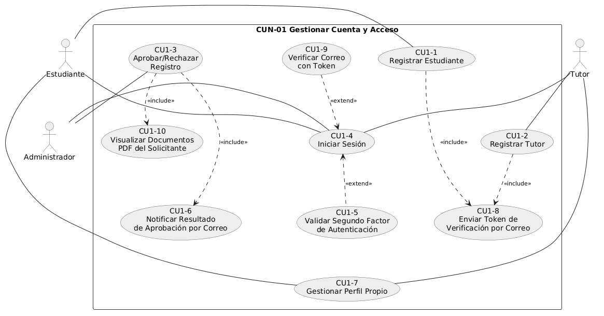
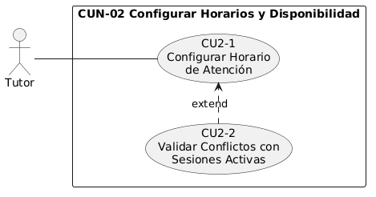
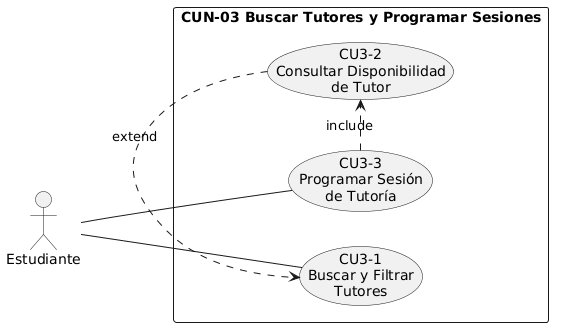
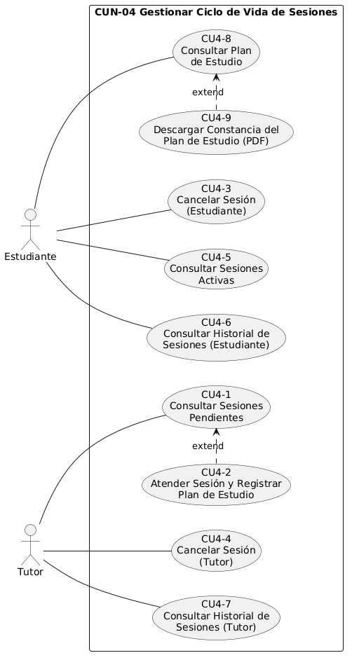
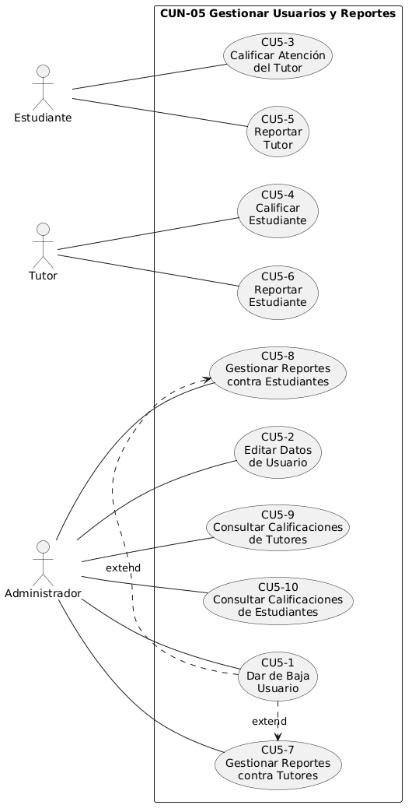
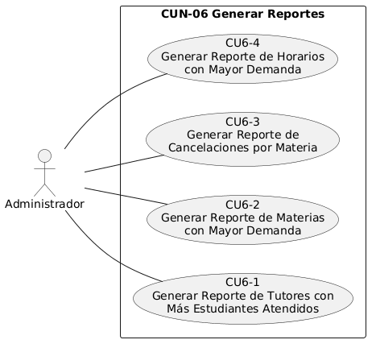

# Diagramas de casos de uso expandidos

**Descripción**

Los diagramas de esta sección expanden cada uno de los seis procesos de negocio (CUN) identificados en la primera descomposición, mostrando los casos de uso puntuales que los conforman, los actores que los ejecutan y las relaciones `<<include>>`/`<<extend>>` existentes entre ellos. Este nivel de detalle permite observar las interacciones específicas entre los actores y el sistema dentro de cada módulo funcional, incluyendo las funcionalidades incorporadas en la fase 2: la verificación de correo con token, el visor de documentos PDF para la aprobación de registros, el plan de estudio estructurado con su constancia en PDF, las calificaciones y los reportes de conducta, y los nuevos reportes analíticos.

## Expansión — CUN-01 Gestionar Cuenta y Acceso

**Descripción**

Este diagrama detalla el proceso de gestión de cuenta y acceso, abarcando el registro de estudiantes y tutores con el envío del token de verificación a su correo, la aprobación o rechazo de dichas solicitudes por parte del administrador mediante la revisión de los documentos PDF del solicitante y la notificación del resultado por correo, el inicio de sesión, la verificación del correo con el token en el primer acceso de estudiantes y tutores, la validación del segundo factor de autenticación exclusiva del administrador, y la gestión del perfil propio de cada usuario.

## Expansión — CUN-02 Configurar Horarios y Disponibilidad

**Descripción**

Este diagrama representa el proceso mediante el cual el tutor define o modifica sus días y franjas horarias de atención. Incluye la validación de conflictos con sesiones activas, la cual se ejecuta únicamente cuando se trata de una modificación sobre un horario ya existente.

## Expansión — CUN-03 Buscar Tutores y Programar Sesiones

**Descripción**

Este diagrama muestra el flujo mediante el cual el estudiante localiza tutores según distintos criterios de búsqueda, consulta su disponibilidad horaria y, finalmente, programa una sesión de tutoría, validando en el proceso que no existan traslapes ni sesiones activas duplicadas con el mismo tutor.

## Expansión — CUN-04 Gestionar Ciclo de Vida de Sesiones

**Descripción**

Este diagrama integra el ciclo de vida completo de una sesión de tutoría una vez programada: la consulta de las sesiones pendientes del tutor y de las sesiones activas del estudiante, la atención de la sesión registrando un plan de estudio estructurado (dificultades identificadas y recursos recomendados), la cancelación por parte del estudiante o del tutor (esta última con notificación automática por correo al estudiante afectado), la consulta del historial de sesiones atendidas y canceladas de ambos roles, y la consulta del plan de estudio por parte del estudiante con la opción de descargar su constancia en PDF.

## Expansión — CUN-05 Gestionar Usuarios y Reportes

**Descripción**

Este diagrama corresponde a la gestión de usuarios y de los reportes y calificaciones entre estudiantes y tutores. El administrador puede editar los datos de los usuarios aprobados y darlos de baja, revisar las denuncias presentadas contra tutores y contra estudiantes resolviéndolas con la baja del usuario denunciado o descartándolas, y consultar las calificaciones promedio de ambos roles. Por su parte, el estudiante y el tutor pueden calificar y reportar a su contraparte en las sesiones atendidas.

## Expansión — CUN-06 Generar Reportes

**Descripción**

Este diagrama corresponde a la generación de reportes analíticos sobre el uso de la plataforma por parte del administrador: los tutores que más estudiantes han atendido y las materias con mayor demanda de sesiones, así como las cancelaciones por materia y los horarios con mayor demanda incorporados en la segunda fase. Los datos se calculan al momento de la consulta.

