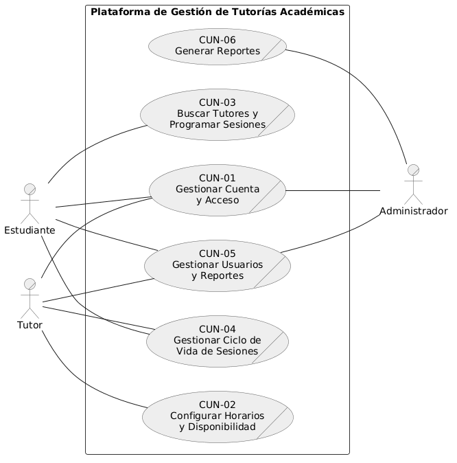

# Primera Descomposicion del Core

## Diagrama de la primera descomposición

**Descripción**

La primera descomposición divide el Caso de Uso Core en los seis procesos de negocio (CUN) que conforman la gestión de tutorías académicas. En este nivel se identifican los actores participantes y las áreas funcionales del sistema (cuenta y acceso con verificación de correo, horarios y disponibilidad, búsqueda y programación de sesiones, ciclo de vida de las sesiones que abarca su atención con plan de estudio, cancelación e historial, gestión de usuarios con los reportes y calificaciones entre estudiantes y tutores, y generación de reportes analíticos), sirviendo como preparación para el desglose detallado de cada proceso.

