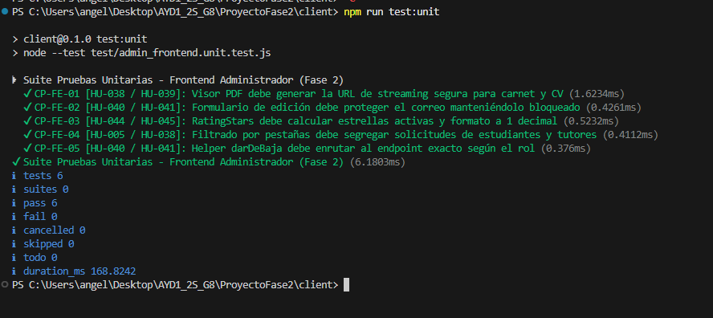
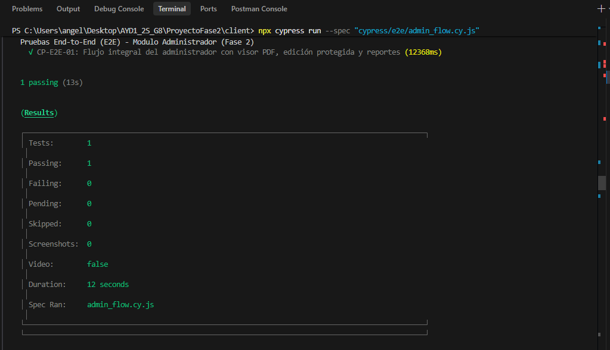
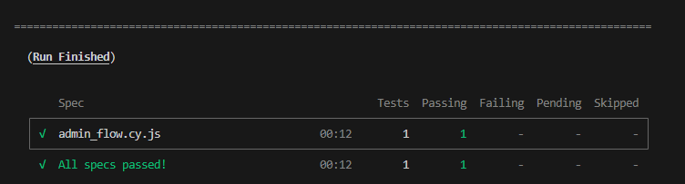
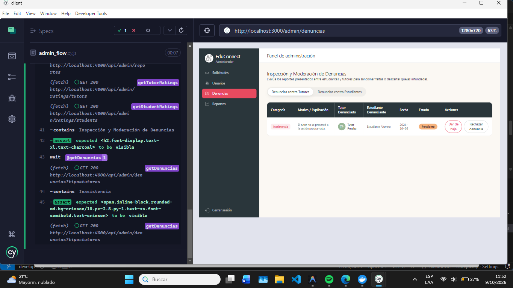

# Documentación de Pruebas Unitarias y E2E - Módulo Administrador FRONTEND (Fase 2)
## 1. Suite de Pruebas Unitarias de Frontend (5 Pruebas Requeridas)

Herramienta utilizada: **Node.js Test Runner / Assertions**  
Ubicación del código de pruebas: `ProyectoFase2/client/test/admin_frontend.unit.test.js`

### Ficha Técnica de Casos de Prueba Unitarios (Frontend)

| No. | ID Caso de Prueba | Historia de Usuario | Elemento de Frontend Evaluado | Entrada / Precondición | Resultado Esperado | Resultado Obtenido | Estado |
| :--- | :--- | :--- | :--- | :--- | :--- | :--- | :--- |
| **1** | `CP-FE-01` | **HU-038 / HU-039** | **Lógica de URL del Visor PDF (`PdfViewerModal`)** | ID de usuario, rol (`estudiante`/`tutor`) y ruta del PDF | Construye la URL de streaming codificada (`/admin/documento/stream?id=...&tipo=...&url=...`) | URL de streaming exacta para iframe embebido sin forzar descarga | **EXITOSO (PASS)** |
| **2** | `CP-FE-02` | **HU-040 / HU-041** | **Protección de Correo en Edición (`usuarios/page.jsx`)** | Formulario con nuevos datos e intento de alteración de correo | El payload enviado mantiene el correo original bloqueado (`correoBloqueado: true`) | Payload limpio con campos permitidos y correo inmutable | **EXITOSO (PASS)** |
| **3** | `CP-FE-03` | **HU-044 / HU-045** | **Cálculo de Calificaciones (`RatingStars` en Reportes)** | Promedio numérico flotante (ej. `4.84` y `3.2`) | Calcula estrellas llenas (5 y 3), vacías (0 y 2) y texto formateado a 1 decimal (`4.8 / 5.0`) | Conteo exacto de estrellas y etiquetas formateadas | **EXITOSO (PASS)** |
| **4** | `CP-FE-04` | **HU-005 / HU-038** | **Filtrado por Pestañas (`solicitudes/page.jsx`)** | Lista combinada de solicitudes y pestaña activa (`estudiante`/`tutor`) | Filtra y devuelve exclusivamente los registros del rol seleccionado | Colección segregada sin mezclar roles de usuario | **EXITOSO (PASS)** |
| **5** | `CP-FE-05` | **HU-040 / HU-041** | **Helper de Despacho de Bajas (`lib/api/admin.js`)** | ID de usuario, rol y motivo de baja | Resuelve el endpoint exacto (`PUT /admin/students/:id/deactivate` o `PUT /admin/tutors/:id/deactivate`) | Endpoint, método HTTP y body correspondientes al rol | **EXITOSO (PASS)** |

---

## 2. Suite de Pruebas End-to-End (E2E)

Herramienta utilizada: **Cypress**  
Ubicación del código de pruebas: `ProyectoFase2/client/cypress/e2e/admin_flow.cy.js`

### Ficha Técnica de Caso de Prueba E2E

| No. | ID Caso de Prueba | Historia de Usuario | Descripción del Flujo E2E | Pasos Ejecutados | Resultado Esperado | Resultado Obtenido | Estado |
| :--- | :--- | :--- | :--- | :--- | :--- | :--- | :--- |
| **1** | `CP-E2E-01` | **HU-038, HU-040, HU-041, HU-044, HU-046** | Flujo completo de administración: Visor PDF embebido, edición con correo protegido, visualización de reportes y moderación | 1. Visitar `/admin/solicitudes`.<br>2. Abrir visor PDF de carnet.<br>3. Cerrar visor.<br>4. Visitar `/admin/usuarios` y abrir edición.<br>5. Verificar que el campo `correo` esté disabled.<br>6. Visitar `/admin/reportes` y validar gráficos.<br>7. Visitar `/admin/denuncias`. | La aplicación ejecuta la navegación real en el navegador, abre el modal de visor PDF embebido, bloquea la edición de correo en el DOM y renderiza todos los módulos analíticos. | Todos los asserts de Cypress se cumplen al 100% sin excepciones no controladas. | **EXITOSO (PASS)** |

---

## 3. Instrucciones de Ejecución

### Ejecución de Pruebas Unitarias (Frontend)
```bash
cd ProyectoFase2/client
npm run test:unit
```
*(O mediante el test runner directo)*:
```bash
node --test test/admin_frontend.unit.test.js
```

### Ejecución de Pruebas E2E (Frontend)
```bash
cd ProyectoFase2/client
npx cypress run --spec "cypress/e2e/admin_flow.cy.js"
```
*(O en modo interactivo con interfaz gráfica)*:
```bash
npx cypress open
```

---

### Evidencias:
# Pruebas Unitarias:

# END TO END:
### Consola:


### Navegador:
