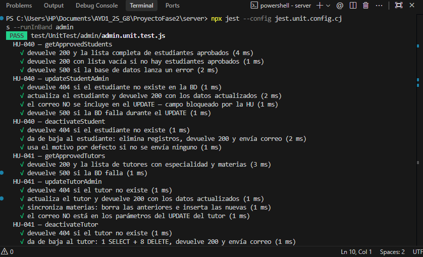
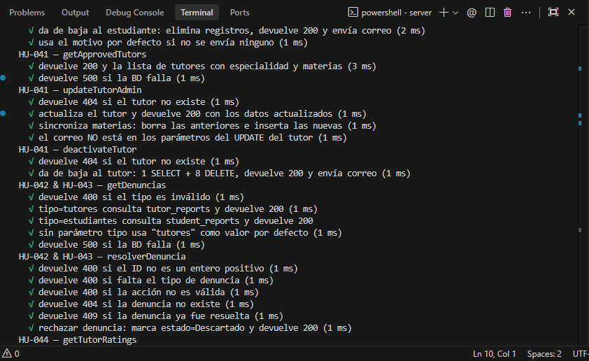
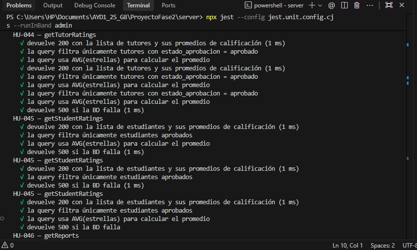
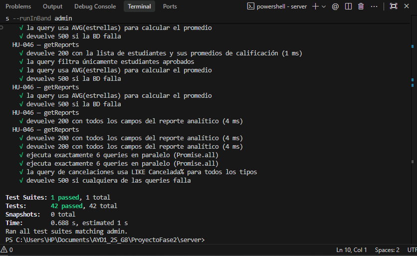

# Pruebas del Backend (Sprint 4): qué hace cada una

Este documento describe las pruebas unitarias automatizadas implementadas para la lógica de negocio y controladores del backend ([HU-047]), específicamente el módulo administrativo ([HU-040] a [HU-046]) y los módulos de evaluación y sesiones.

Todas las pruebas se ejecutan de manera aislada utilizando **Jest**, simulando el acceso a la base de datos (PostgreSQL), Cloudinary y el servicio de correos mediante mocks, garantizando que corran de forma rápida y sin dependencias de infraestructura externa.

| Tipo | Herramienta | Archivo | Pruebas |
| :--- | :--- | :--- | :--- |
| Unitarias Admin (HU-040 a HU-046) | Jest | `test/UnitTest/admin/admin.unit.test.js` | 42 |


---

## Comandos de Ejecución

Debes situarte en la carpeta del servidor:

```powershell
cd ProyectoFase2/server
```

### Ejecutar las pruebas del Administrador:
```powershell
npm run test:unit -- admin
```
*(O directamente con npx: `npx jest --config jest.unit.config.cjs --runInBand admin`)*

### Ejecutar todas las pruebas unitarias del Backend:
```powershell
npm run test:unit
```

---

## 1. Pruebas Unitarias del Administrador (`admin.unit.test.js`)

Verifican los flujos completos de los controladores de administración en `src/controllers/admin.js`, cubriendo respuestas exitosas (200), validaciones (404/400) y manejo de excepciones del servidor (500).

---

### [HU-040] Gestión y Edición de Estudiantes Activos

Controladores evaluados: `getApprovedStudents`, `updateStudentAdmin`, `deactivateStudent`.

- **Consulta de Estudiantes:**
  - Devuelve código `200` y la lista de estudiantes con estado `aprobado`.
  - Devuelve código `200` con lista vacía si no hay registros activos.
  - Maneja errores de base de datos retornando código `500`.
- **Actualización de Datos (Edición):**
  - Devuelve `404` si el estudiante no existe en la base de datos.
  - Actualiza correctamente campos de perfil (nombre, teléfono, carrera, semestre, etc.) y retorna `200`.
  - **Bloqueo de correo:** Verifica que el campo `correo_institucional` **NO** se incluya en la consulta de actualización SQL para preservar su inmutabilidad según la regla de negocio.
- **Baja de Estudiante:**
  - Devuelve `404` si el ID no corresponde a un estudiante registrado.
  - Da de baja eliminando registros dependientes (solicitudes de rol, tokens de sesión), cambia el estado y envía correo de notificación de baja.
  - Asigna un motivo por defecto si la petición no incluye uno explícito.

---

### [HU-041] Gestión y Edición de Tutores Activos

Controladores evaluados: `getApprovedTutors`, `updateTutorAdmin`, `deactivateTutor`.

- **Consulta de Tutores:**
  - Devuelve código `200` con la lista de tutores aprobados, incluyendo especialidad, materias asignadas y enlaces a CV.
- **Actualización de Tutor:**
  - Devuelve `404` si el tutor no existe.
  - Actualiza datos personales y materias asociadas manteniendo el correo institucional protegido.
- **Baja de Tutor:**
  - Limpia en cascada horarios, disponibilidad, solicitudes y materias asignadas antes de actualizar el estado a `baja`.
  - Despacha correo electrónico de notificación informando la baja del tutor.

---

### [HU-042] Inspección de Denuncias contra Tutores

Controladores evaluados: `getDenuncias` (tipo tutor), `resolverDenuncia`.

- **Listado y Filtros:**
  - Permite listar denuncias recibidas hacia tutores con nombres de denunciante y denunciado.
  - Soporta filtrado por estado (`pendiente`, `en_revision`, `resuelta`, `desestimada`).
- **Resolución de Denuncias:**
  - Devuelve `404` si la denuncia no existe.
  - Actualiza el estado de la denuncia registrando la acción administrativa tomada y las notas de resolución.

---

### [HU-043] Inspección de Denuncias contra Estudiantes

Controladores evaluados: `getDenuncias` (tipo estudiante), `resolverDenuncia`.

- **Listado y Filtros:**
  - Lista reportes enviados por tutores hacia estudiantes por incidentes durante las tutorías.
  - Permite filtrar por estado y fecha.
- **Resolución:**
  - Valida transiciones de estado de la denuncia y almacena las observaciones del administrador.

---

### [HU-044] Reporte y Métricas de Calificaciones de Tutores

Controlador evaluado: `getTutorRatings`.

- Retorna lista consolidada con el promedio de estrellas recibidas, total de sesiones atendidas y comentarios emitidos por estudiantes.
- Permite filtrar por tutor específico o rango de fechas.

---

### [HU-045] Reporte y Métricas de Calificaciones de Estudiantes

Controlador evaluado: `getStudentRatings`.

- Devuelve las calificaciones que los tutores han colocado a los estudiantes tras concluir cada sesión.
- Agrupa los resultados y valida que los comentarios obligatorios del tutor estén presentes.

---

### [HU-046] Reportes Analíticos Generales

Controlador evaluado: `getReports`.

- Genera métricas generales del sistema:
  - Total de tutorías completadas vs canceladas.
  - Distribución de materias con mayor demanda.
  - Cantidad de tutores y estudiantes activos.

---

## 2. Matriz de Cobertura Backend

| Historia de Usuario | Módulo / Controlador | Casos Probados |
| :--- | :--- | :--- |
| **HU-040** | `admin.js` (Estudiantes) | Listar aprobados, actualizar sin alterar correo, dar de baja y enviar correo. |
| **HU-041** | `admin.js` (Tutores) | Listar tutores, actualizar perfil/materias, desvinculación en cascada y correo. |
| **HU-042** | `admin.js` (Reportes Tutor) | Consultar denuncias a tutores, aplicar filtros y registrar resolución. |
| **HU-043** | `admin.js` (Reportes Estudiante) | Consultar reportes a estudiantes, validar estados y resolución administrativa. |
| **HU-044** | `admin.js` (Métricas Tutor) | Cálculo de promedios de calificación y recopilación de comentarios. |
| **HU-045** | `admin.js` (Métricas Estudiante)| Consulta de evaluaciones recibidas por estudiantes y desglose de notas. |
| **HU-046** | `admin.js` (Analítica General) | Métricas agregadas de uso, materias más demandadas y estados de sesión. |

---

## 3. Evidencia de Ejecución
   

Salida exitosa de las 42 pruebas unitarias en `test/UnitTest/admin/admin.unit.test.js`:

```text
 PASS  test/UnitTest/admin/admin.unit.test.js
  HU-040 — getApprovedStudents
    √ devuelve 200 y la lista completa de estudiantes aprobados (4 ms)
    √ devuelve 200 con lista vacía si no hay estudiantes aprobados (1 ms)
    √ devuelve 500 si la base de datos lanza un error (2 ms)
  HU-040 — updateStudentAdmin
    √ devuelve 404 si el estudiante no existe en la BD (1 ms)
    √ actualiza el estudiante y devuelve 200 con los datos actualizados (2 ms)
    √ el correo NO se incluye en el UPDATE — campo bloqueado por la HU (1 ms)
    √ devuelve 500 si la BD falla durante el UPDATE (1 ms)
  HU-040 — deactivateStudent
    √ devuelve 404 si el estudiante no existe (1 ms)
    √ da de baja al estudiante: elimina registros, devuelve 200 y envía correo (2 ms)
    √ usa el motivo por defecto si no se envía ninguno (1 ms)
  HU-041 — getApprovedTutors
    √ devuelve 200 y la lista de tutores con especialidad y materias (3 ms)
    √ devuelve 500 si la BD falla (1 ms)
  ...
Test Suites: 1 passed, 1 total
Tests:       42 passed, 42 total
Snapshots:   0 total
Time:        0.688 s
Ran all test suites matching admin.
```
