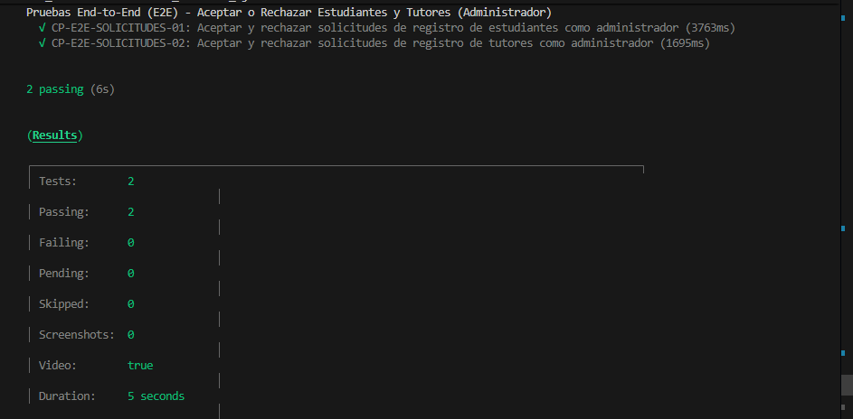
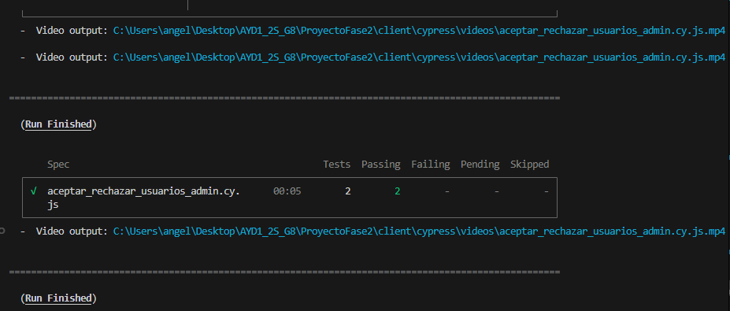
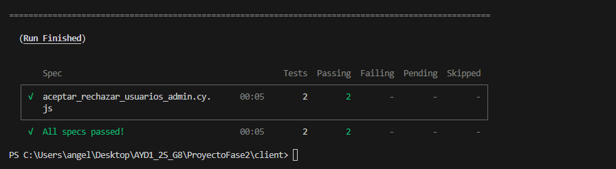
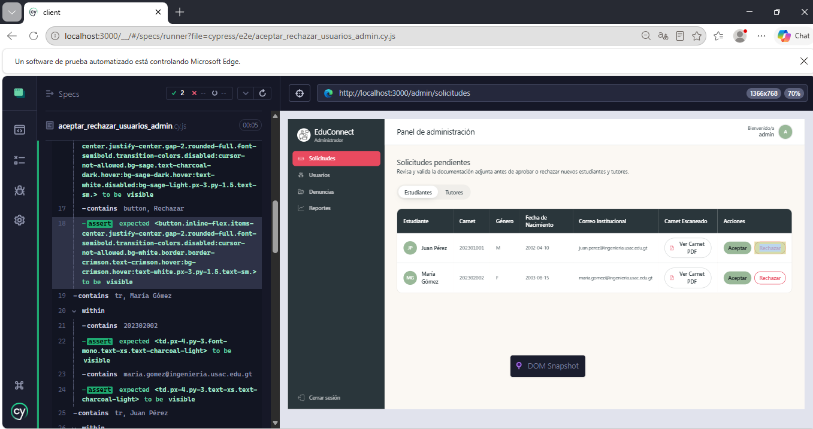
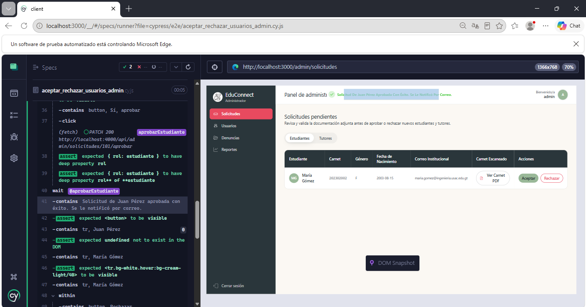
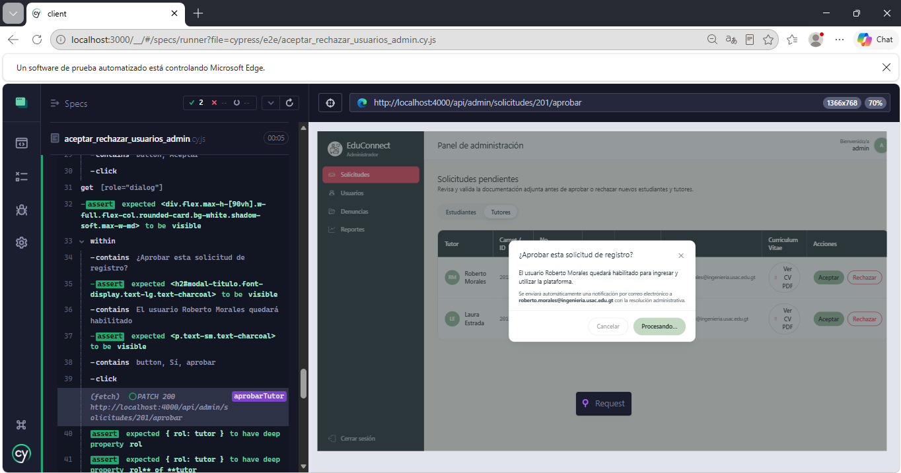

# Documentación de Pruebas End-to-End (E2E) - Aceptar o Rechazar Estudiantes y Tutores (Administrador)

Este documento describe la especificación técnica, diseño de casos de prueba, comandos de ejecución y resultados de la suite automatizada End-to-End (E2E) desarrollada con **Cypress** para validar la funcionalidad de:

> **"Aceptar o rechazar estudiantes o tutores como admin."**

---

## 1. Información General del Entorno de Pruebas

- **Herramienta de automatización:** Cypress v14.5.4
- **Navegador de pruebas:** Electron (Headless) / Google Chrome
- **URL Base de la aplicación frontend:** `http://localhost:3000`
- **URL Base del API backend:** `http://localhost:4000/api`
- **Ubicación del archivo de prueba:** `ProyectoFase2/client/cypress/e2e/aceptar_rechazar_usuarios_admin.cy.js`
- **Configuración de Cypress:** `ProyectoFase2/client/cypress.config.cjs`

---

## 2. Ficha Técnica de Casos de Prueba E2E

| No. | ID Caso de Prueba | Funcionalidad Evaluada | Rol Evaluado | Precondición | Pasos Ejecutados | Resultado Esperado | Resultado Obtenido | Estado |
| :--- | :--- | :--- | :--- | :--- | :--- | :--- | :--- | :--- |
| **1** | `CP-E2E-SOLICITUDES-01` | **Aceptar y rechazar solicitudes de registro de estudiantes como administrador** | Administrador | Usuario con rol administrador autenticado en la plataforma. Solicitudes de registro de estudiantes pendientes de validación. | 1. Acceder a la vista de solicitudes pendientes (`/admin/solicitudes`).<br>2. Validar que la pestaña activa corresponda a "Estudiantes".<br>3. Verificar que se listen las solicitudes pendientes con sus datos de registro (carnet, correo institucional, nombre).<br>4. En la fila del estudiante Juan Pérez, presionar "Aceptar".<br>5. Confirmar la habilitación en el modal interactivo pulsando "Sí, aprobar".<br>6. Validar la petición HTTP PATCH al backend (`/admin/solicitudes/101/aprobar`) y la notificación toast de éxito.<br>7. En la fila de la estudiante María Gómez, presionar "Rechazar".<br>8. Confirmar en el modal de declinación pulsando "Sí, rechazar".<br>9. Validar la petición HTTP PATCH al backend (`/admin/solicitudes/102/rechazar`) y la notificación toast informativa. | El administrador puede aprobar o declinar solicitudes estudiantiles. La aprobación habilita al alumno en el sistema y envía confirmación por correo, mientras que el rechazo cancela el registro notificando al solicitante; en ambos casos las filas se actualizan dinámicamente. | Peticiones HTTP PATCH enviadas con el parámetro `rol: "estudiante"`, notificaciones toast desplegadas (`"Solicitud de Juan Pérez aprobada con éxito."` y `"Solicitud de María Gómez rechazada."`), y actualización inmediata del listado a estado vacío. | **EXITOSO (PASS)** |
| **2** | `CP-E2E-SOLICITUDES-02` | **Aceptar y rechazar solicitudes de registro de tutores como administrador** | Administrador | Usuario con rol administrador autenticado en la plataforma. Solicitudes de registro de tutores pendientes con especialidades y documentación adjunta. | 1. Acceder a la vista de solicitudes pendientes (`/admin/solicitudes`).<br>2. Cambiar a la pestaña "Tutores".<br>3. Comprobar que la tabla liste a los tutores solicitantes mostrando número de identificación, carnet, especialidad y correo.<br>4. En la fila de Roberto Morales, hacer clic en "Aceptar" y confirmar en el modal mediante "Sí, aprobar".<br>5. Validar la petición HTTP PATCH al backend (`/admin/solicitudes/201/aprobar`) con `rol: "tutor"`.<br>6. En la fila de Laura Estrada, hacer clic en "Rechazar" y confirmar en el modal mediante "Sí, rechazar".<br>7. Validar la petición HTTP PATCH al backend (`/admin/solicitudes/202/rechazar`) con `rol: "tutor"`.<br>8. Comprobar los mensajes de notificación toast y el estado vacío de la tabla. | El administrador gestiona las solicitudes de tutores evaluando sus datos y especialidades. La aprobación activa la cuenta docente para impartir tutorías y el rechazo descarta el perfil, enviando notificaciones automatizadas por correo en cada resolución. | Pestaña conmutada a Tutores con datos de especialidad visibles, peticiones PATCH de aprobación y rechazo validadas con código HTTP 200, toasts de confirmación mostrados y filas removidas en tiempo real. | **EXITOSO (PASS)** |

---

## 3. Comandos de Ejecución

### Prerrequisito: Levantar el Entorno Local

Asegurarse de que los servicios se encuentren arriba con Docker Compose:

```bash
cd ProyectoFase2
docker compose up --build
```

### Ejecución en Modo Headless (Línea de Comandos)

Para ejecutar únicamente la suite de aceptación y rechazo de usuarios:

```bash
cd ProyectoFase2/client
npx cypress run --spec "cypress/e2e/aceptar_rechazar_usuarios_admin.cy.js"
```

### Ejecución en Modo Interactivo con Interfaz Gráfica

Para abrir el explorador interactivo de Cypress y observar la prueba en tiempo real:

```bash
cd ProyectoFase2/client
npx cypress open
```

1. Seleccionar la opción **E2E Testing**.
2. Elegir navegador (Electron, Chrome o Edge).
3. Seleccionar `aceptar_rechazar_usuarios_admin.cy.js` para iniciar la ejecución interactiva.

---

## 4. Evidencias de Ejecución en Consola

Salida real obtenida durante la ejecución automatizada de Cypress:

```text
====================================================================================================

  (Run Starting)

  ┌────────────────────────────────────────────────────────────────────────────────────────────────┐
  │ Cypress:        14.5.4                                                                         │
  │ Browser:        Electron 130 (headless)                                                        │
  │ Node Version:   v22.20.0 (C:\Program Files\nodejs\node.exe)                                    │
  │ Specs:          1 found (aceptar_rechazar_usuarios_admin.cy.js)                                │
  │ Searched:       C:\Users\angel\Desktop\AYD1_2S_G8\ProyectoFase2\client\cypress\e2e\aceptar_rec │
  │                 hazar_usuarios_admin.cy.js                                                     │
  └────────────────────────────────────────────────────────────────────────────────────────────────┘


────────────────────────────────────────────────────────────────────────────────────────────────────
                                                                                                    
  Running:  aceptar_rechazar_usuarios_admin.cy.js                                           (1 of 1)


  Pruebas End-to-End (E2E) - Aceptar o Rechazar Estudiantes y Tutores (Administrador)
    √ CP-E2E-SOLICITUDES-01: Aceptar y rechazar solicitudes de registro de estudiantes como administrador (4619ms)
    √ CP-E2E-SOLICITUDES-02: Aceptar y rechazar solicitudes de registro de tutores como administrador (1956ms)


  2 passing (7s)


  (Results)

  ┌────────────────────────────────────────────────────────────────────────────────────────────────┐
  │ Tests:        2                                                                                │
  │ Passing:      2                                                                                │
  │ Failing:      0                                                                                │
  │ Pending:      0                                                                                │
  │ Skipped:      0                                                                                │
  │ Screenshots:  0                                                                                │
  │ Video:        true                                                                             │
  │ Duration:     6 seconds                                                                        │
  │ Spec Ran:     aceptar_rechazar_usuarios_admin.cy.js                                            │
  └────────────────────────────────────────────────────────────────────────────────────────────────┘


  (Video)

  -  Video output: C:\Users\angel\Desktop\AYD1_2S_G8\ProyectoFase2\client\cypress\videos\aceptar_rechazar_usuarios_admin.cy.js.mp4


====================================================================================================

  (Run Finished)


       Spec                                              Tests  Passing  Failing  Pending  Skipped  
  ┌────────────────────────────────────────────────────────────────────────────────────────────────┐
  │ √  aceptar_rechazar_usuarios_admin.cy.      00:06        2        2        -        -        - │
  │    js                                                                                          │
  └────────────────────────────────────────────────────────────────────────────────────────────────┘
    √  All specs passed!                        00:06        2        2        -        -        -  
```

---

## 5. Evidencias





