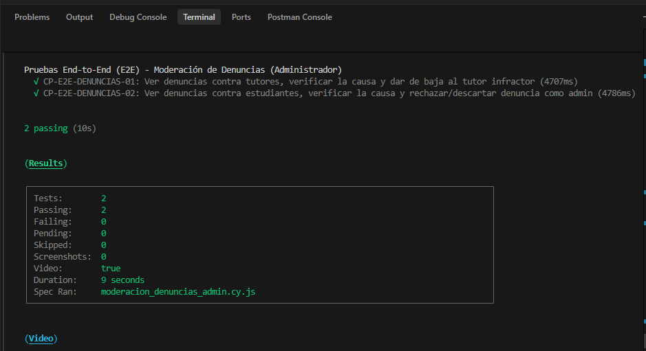
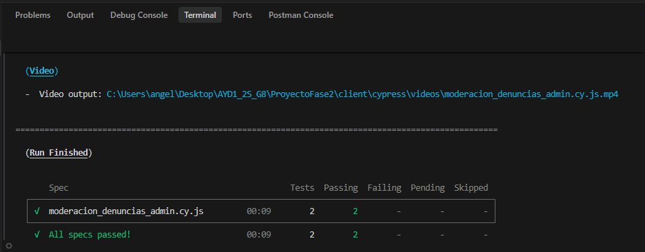
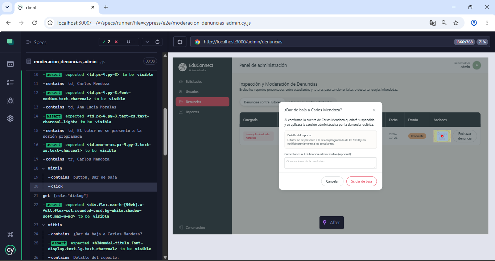
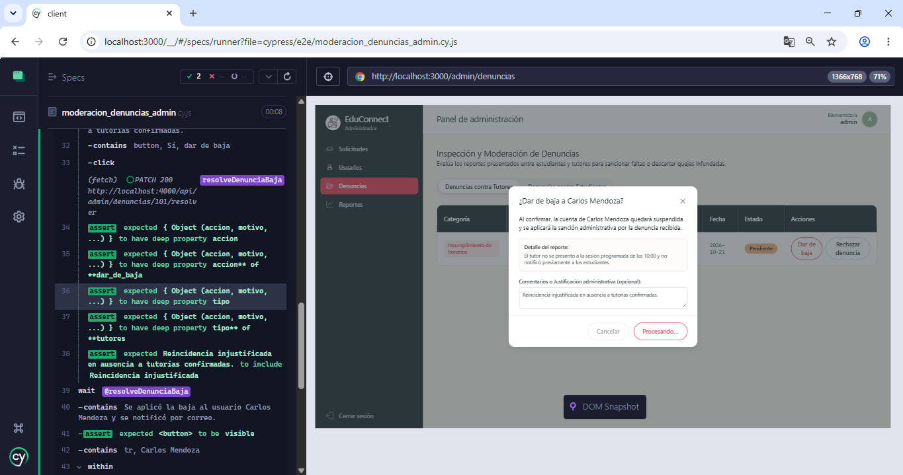
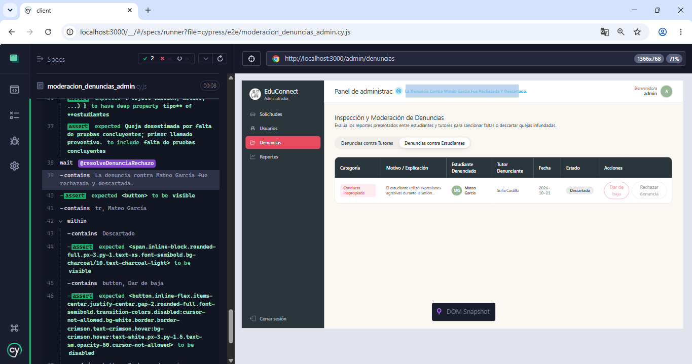

# Documentación de Pruebas End-to-End (E2E) - Moderación de Denuncias (Administrador)

Este documento describe la especificación técnica, diseño de casos de prueba, comandos de ejecución y resultados de la suite automatizada End-to-End (E2E) desarrollada con **Cypress** para validar la funcionalidad de:

> **"Ver estudiantes y tutores denunciados, verificar la causa de la denuncia y dar de baja o rechazar como admin."**

---

## 1. Información General del Entorno de Pruebas

- **Herramienta de automatización:** Cypress v14.5.4
- **Navegador de pruebas:** Electron (Headless) / Google Chrome
- **URL Base de la aplicación frontend:** `http://localhost:3000`
- **URL Base del API backend:** `http://localhost:4000/api`
- **Ubicación del archivo de prueba:** `ProyectoFase2/client/cypress/e2e/moderacion_denuncias_admin.cy.js`
- **Configuración de Cypress:** `ProyectoFase2/client/cypress.config.cjs`

---

## 2. Ficha Técnica de Casos de Prueba E2E

| No. | ID Caso de Prueba | Funcionalidad Evaluada | Rol Evaluado | Precondición | Pasos Ejecutados | Resultado Esperado | Resultado Obtenido | Estado |
| :--- | :--- | :--- | :--- | :--- | :--- | :--- | :--- | :--- |
| **1** | `CP-E2E-DENUNCIAS-01` | **Ver denuncias contra tutores, verificar la causa y dar de baja al tutor infractor** | Administrador | Usuario con rol administrador autenticado en la plataforma. Denuncia activa registrada contra un tutor. | 1. Acceder al panel de moderación de denuncias (`/admin/denuncias`).<br>2. Validar que la pestaña activa corresponda a "Denuncias contra Tutores".<br>3. Comprobar que la tabla liste al tutor denunciado ("Carlos Mendoza"), la categoría ("Incumplimiento de horarios"), el estudiante denunciante y el motivo visible en la columna correspondiente.<br>4. Presionar el botón "Dar de baja" en la fila del tutor.<br>5. Validar la apertura del modal de confirmación con la causa detallada del reporte.<br>6. Ingresar justificación administrativa en el campo de texto: `"Reincidencia injustificada en ausencia a tutorías confirmadas."`.<br>7. Confirmar la sanción haciendo clic en "Sí, dar de baja".<br>8. Validar el envío de la petición HTTP PATCH al backend. | El sistema abre el modal de resolución exponiendo la causa y motivo de la queja. Al confirmar la baja, se procesa la suspensión del tutor en el backend, se muestra una notificación toast informativa y el estado de la fila cambia a "Sancionado" con los botones de acción inhabilitados. | Modal de resolución desplegado correctamente con el detalle de la denuncia, petición PATCH validada con código HTTP 200, toast `"Se aplicó la baja al usuario Carlos Mendoza y se notificó por correo."` visible y estado actualizado a "Sancionado". | **EXITOSO (PASS)** |
| **2** | `CP-E2E-DENUNCIAS-02` | **Ver denuncias contra estudiantes, verificar la causa y rechazar/descartar denuncia como admin** | Administrador | Usuario con rol administrador autenticado en la plataforma. Denuncia activa registrada contra un estudiante. | 1. Acceder al panel de moderación de denuncias (`/admin/denuncias`).<br>2. Cambiar a la pestaña "Denuncias contra Estudiantes".<br>3. Validar la petición al backend con parámetro `tipo=estudiantes`.<br>4. Comprobar que la tabla liste al estudiante denunciado ("Mateo García"), la categoría ("Conducta inapropiada") y la causa de la denuncia.<br>5. Presionar el botón "Rechazar denuncia" en la fila del estudiante.<br>6. En el modal de descarte, verificar el detalle del reporte y digitar las observaciones administrativas: `"Queja desestimada por falta de pruebas concluyentes; primer llamado preventivo."`.<br>7. Confirmar haciendo clic en "Sí, rechazar denuncia".<br>8. Validar la petición HTTP PATCH enviada al servidor. | El administrador puede alternar entre pestañas para consultar reportes contra estudiantes. Al rechazar una denuncia infundada, el sistema procesa el descarte sin afectar la cuenta del alumno, despliega retroalimentación mediante toast y actualiza el estado de la fila a "Descartado". | Pestaña conmutada y datos del estudiante cargados, modal interactivo validado con la causa del reporte, petición PATCH procesada con éxito, notificación toast visible y estado actualizado a "Descartado". | **EXITOSO (PASS)** |

---

## 3. Comandos de Ejecución

### Prerrequisito: Levantar el Entorno Local

Asegurarse de que los servicios se encuentren arriba con Docker Compose:

```bash
cd ProyectoFase2
docker compose up --build
```

### Ejecución en Modo Headless (Línea de Comandos)

Para ejecutar únicamente la suite de moderación de denuncias del administrador:

```bash
cd ProyectoFase2/client
npx cypress run --spec "cypress/e2e/moderacion_denuncias_admin.cy.js"
```

### Ejecución en Modo Interactivo con Interfaz Gráfica

Para abrir el explorador interactivo de Cypress y observar la prueba en tiempo real:

```bash
cd ProyectoFase2/client
npx cypress open
```

1. Seleccionar la opción **E2E Testing**.
2. Elegir navegador (Electron, Chrome o Edge).
3. Seleccionar `moderacion_denuncias_admin.cy.js` para iniciar la ejecución interactiva.

---

## 4. Evidencias de Ejecución en Consola

Salida real obtenida durante la ejecución automatizada de Cypress:

```text
====================================================================================================

  (Run Starting)

  ┌────────────────────────────────────────────────────────────────────────────────────────────────┐
  │ Cypress:        14.5.4                                                                         │
  │ Browser:        Electron 130 (headless)                                                        │
  │ Node Version:   v22.20.0 (C:\Program Files\nodejs\node.exe)                                    │
  │ Specs:          1 found (moderacion_denuncias_admin.cy.js)                                     │
  │ Searched:       C:\Users\angel\Desktop\AYD1_2S_G8\ProyectoFase2\client\cypress\e2e\moderacion_ │
  │                 denuncias_admin.cy.js                                                          │
  └────────────────────────────────────────────────────────────────────────────────────────────────┘


────────────────────────────────────────────────────────────────────────────────────────────────────
                                                                                                    
  Running:  moderacion_denuncias_admin.cy.js                                                (1 of 1)


  Pruebas End-to-End (E2E) - Moderación de Denuncias (Administrador)
    √ CP-E2E-DENUNCIAS-01: Ver denuncias contra tutores, verificar la causa y dar de baja al tutor infractor (6138ms)
    √ CP-E2E-DENUNCIAS-02: Ver denuncias contra estudiantes, verificar la causa y rechazar/descartar denuncia como admin (4189ms)


  2 passing (11s)


  (Results)

  ┌────────────────────────────────────────────────────────────────────────────────────────────────┐
  │ Tests:        2                                                                                │
  │ Passing:      2                                                                                │
  │ Failing:      0                                                                                │
  │ Pending:      0                                                                                │
  │ Skipped:      0                                                                                │
  │ Screenshots:  0                                                                                │
  │ Video:        true                                                                             │
  │ Duration:     10 seconds                                                                       │
  │ Spec Ran:     moderacion_denuncias_admin.cy.js                                                 │
  └────────────────────────────────────────────────────────────────────────────────────────────────┘


  (Video)

  -  Video output: C:\Users\angel\Desktop\AYD1_2S_G8\ProyectoFase2\client\cypress\videos\moderacion_denuncias_admin.cy.js.mp4


====================================================================================================

  (Run Finished)


       Spec                                              Tests  Passing  Failing  Pending  Skipped  
  ┌────────────────────────────────────────────────────────────────────────────────────────────────┐
  │ √  moderacion_denuncias_admin.cy.js         00:10        2        2        -        -        - │
  └────────────────────────────────────────────────────────────────────────────────────────────────┘
    √  All specs passed!                        00:10        2        2        -        -        -  
```

---

## 5. Evidencias





