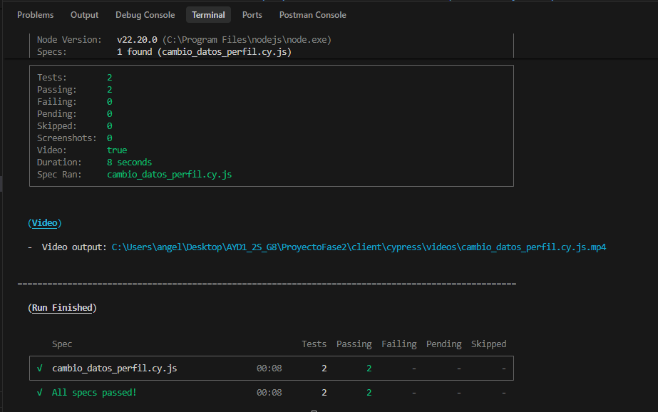
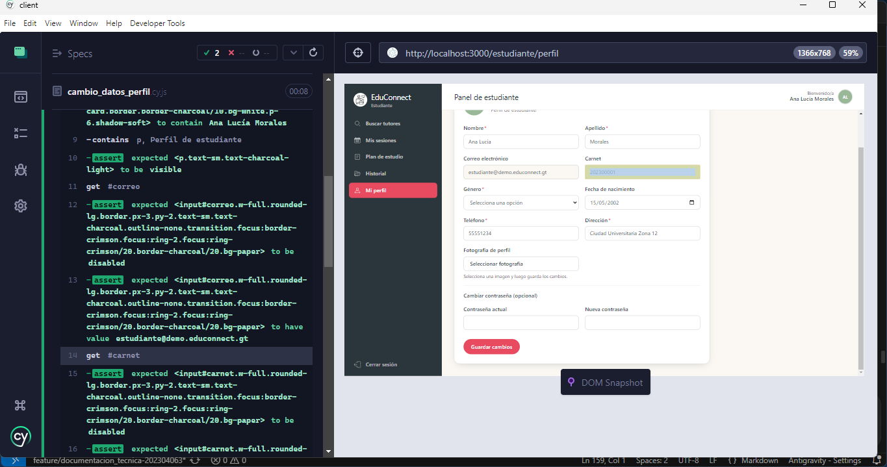
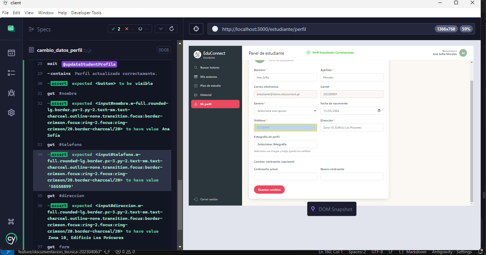
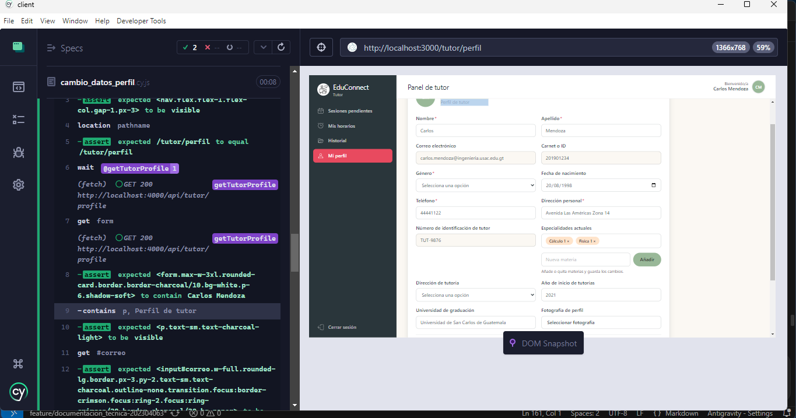
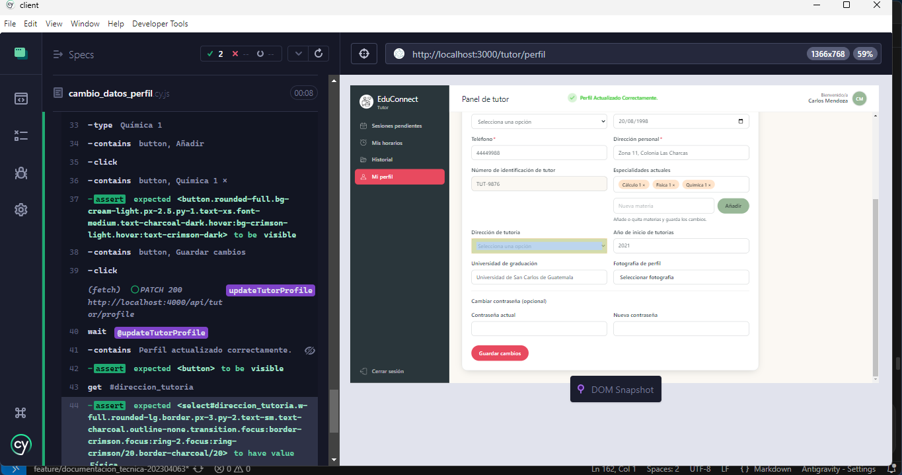

# Documentación de Pruebas End-to-End (E2E) - Cambio de Datos en Perfil (Estudiante y Tutor)

Este documento describe la especificación técnica, diseño de casos de prueba, comandos de ejecución y resultados de la suite automatizada End-to-End (E2E) desarrollada con **Cypress** para validar la funcionalidad de:

> **"Cambio de datos en perfil, estudiante y tutor."**

---

## 1. Información General del Entorno de Pruebas

- **Herramienta de automatización:** Cypress v14.5.4
- **Navegador de pruebas:** Electron (Headless) / Google Chrome
- **URL Base de la aplicación frontend:** `http://localhost:3000`
- **URL Base del API backend:** `http://localhost:4000/api`
- **Ubicación del archivo de prueba:** `ProyectoFase2/client/cypress/e2e/cambio_datos_perfil.cy.js`
- **Configuración de Cypress:** `ProyectoFase2/client/cypress.config.cjs`

---

## 2. Ficha Técnica de Casos de Prueba E2E

| No. | ID Caso de Prueba | Funcionalidad Evaluada | Rol Evaluado | Precondición | Pasos Ejecutados | Resultado Esperado | Resultado Obtenido | Estado |
| :--- | :--- | :--- | :--- | :--- | :--- | :--- | :--- | :--- |
| **1** | `CP-E2E-PERFIL-01` | **Cambio de datos en perfil del estudiante** | Estudiante | Usuario estudiante autenticado en la plataforma con perfil previamente registrado. | 1. Visitar la pantalla de perfil (`/estudiante/perfil`).<br>2. Validar que los campos inmutables (`correo` institucional y `carnet`) se encuentren deshabilitados (`disabled`) para edición.<br>3. Modificar campos editables de contacto: cambiar nombre a `"Ana Sofía"`, actualizar teléfono a `"55558899"` y dirección personal a `"Zona 10, Edificio Los Próceres"`.<br>4. Hacer clic en "Guardar cambios".<br>5. Validar la petición HTTP PUT al backend y la respuesta del servidor. | Los campos protegidos no pueden ser alterados. El sistema envía los datos modificados al servidor, muestra notificación toast de confirmación y actualiza los valores del perfil en pantalla. | Validación de campos bloqueados exitosa, notificación toast `"Perfil actualizado correctamente."` visible y datos actualizados en el DOM. | **EXITOSO (PASS)** |
| **2** | `CP-E2E-PERFIL-02` | **Cambio de datos en perfil del tutor y gestión de especialidades** | Tutor | Usuario tutor autenticado en la plataforma con especialidades previas registradas. | 1. Visitar la pantalla de perfil (`/tutor/perfil`).<br>2. Validar que los campos inmutables (`correo`, `carnet_id` y `numero_identificacion_tutor`) se encuentren deshabilitados.<br>3. Actualizar teléfono a `"44449988"` y dirección personal a `"Zona 11, Colonia Las Charcas"`.<br>4. Modificar la modalidad de atención seleccionando `"Física"`.<br>5. Agregar una nueva especialidad académica (`"Química 1"`) mediante el campo dinámico y presionar "Añadir".<br>6. Confirmar la aparición de la etiqueta interactiva `"Química 1 ×"`.<br>7. Hacer clic en "Guardar cambios". | La información del tutor se actualiza en el servidor vía PATCH. Se reflejan los nuevos valores de contacto, modalidad y especialidades asignadas, con retroalimentación visual al usuario. | Notificación toast `"Perfil actualizado correctamente."` desplegada, modalidad actualizada y nueva materia agregada a la lista de especialidades. | **EXITOSO (PASS)** |

---

## 3. Comandos de Ejecución

### Prerrequisito: Levantar el Entorno Local

Asegurarse de que los servicios se encuentren arriba con Docker Compose:

```bash
cd ProyectoFase2
docker compose up --build
```

### Ejecución en Modo Headless (Línea de Comandos)

Para ejecutar únicamente la suite de cambio de datos de perfil:

```bash
cd ProyectoFase2/client
npx cypress run --config-file cypress.config.cjs --spec "cypress/e2e/cambio_datos_perfil.cy.js"
```

*(O de forma directa si no existen archivos de configuración duplicados)*:

```bash
npx cypress run --spec "cypress/e2e/cambio_datos_perfil.cy.js"
```

### Ejecución en Modo Interactivo con Interfaz Gráfica

Para abrir el explorador interactivo de Cypress y ver la prueba en tiempo real:

```bash
cd ProyectoFase2/client
npx cypress open
```

1. Seleccionar **E2E Testing**.
2. Elegir navegador (Electron, Chrome o Edge).
3. Seleccionar `cambio_datos_perfil.cy.js` para iniciar la ejecución interactiva.

---

## 4. Evidencias de Ejecución en Consola

Salida real obtenida durante la ejecución automatizada de Cypress:

```text
====================================================================================================

  (Run Starting)

  ┌────────────────────────────────────────────────────────────────────────────────────────────────┐
  │ Cypress:        14.5.4                                                                         │
  │ Browser:        Electron 130 (headless)                                                        │
  │ Node Version:   v22.20.0 (C:\Program Files\nodejs\node.exe)                                    │
  │ Specs:          1 found (cambio_datos_perfil.cy.js)                                            │
  │ Searched:       C:\Users\angel\Desktop\AYD1_2S_G8\ProyectoFase2\client\cypress\e2e\cambio_dato │
  │                 s_perfil.cy.js                                                                 │
  └────────────────────────────────────────────────────────────────────────────────────────────────┘


────────────────────────────────────────────────────────────────────────────────────────────────────
                                                                                                    
  Running:  cambio_datos_perfil.cy.js                                                       (1 of 1)


  Pruebas End-to-End (E2E) - Cambio de Datos en Perfil (Estudiante y Tutor)
    √ CP-E2E-PERFIL-01: Cambio de datos en perfil del estudiante (5431ms)
    √ CP-E2E-PERFIL-02: Cambio de datos en perfil del tutor y gestión de especialidades (4915ms)


  2 passing (11s)


  (Results)

  ┌────────────────────────────────────────────────────────────────────────────────────────────────┐
  │ Tests:        2                                                                                │
  │ Passing:      2                                                                                │
  │ Failing:      0                                                                                │
  │ Pending:      0                                                                                │
  │ Skipped:      0                                                                                │
  │ Screenshots:  0                                                                                │
  │ Video:        true                                                                             │
  │ Duration:     10 seconds                                                                       │
  │ Spec Ran:     cambio_datos_perfil.cy.js                                                        │
  └────────────────────────────────────────────────────────────────────────────────────────────────┘


====================================================================================================

  (Run Finished)


       Spec                                              Tests  Passing  Failing  Pending  Skipped  
  ┌────────────────────────────────────────────────────────────────────────────────────────────────┐
  │ √  cambio_datos_perfil.cy.js                00:10        2        2        -        -        - │
  └────────────────────────────────────────────────────────────────────────────────────────────────┘
    √  All specs passed!                        00:10        2        2        -        -        -  
```

---

## 5. Estructura de Archivos del Proyecto

```text
ProyectoFase2/
├── client/
│   ├── cypress.config.cjs
│   └── cypress/
│       ├── e2e/
│       │   ├── admin_flow.cy.js
│       │   ├── cambio_datos_perfil.cy.js
│       │   ├── e2e.cy.js
│       │   └── verificacion_2fa_y_tutor.cy.js
│       └── support/
│           └── e2e.js
└── documentacion/
    └── pruebas/
        ├── README.md
        ├── pruebas e2e perfil estudiante y tutor/
        │   └── README.md
        └── pruebas unitarias 2fa y tutor/
            ├── README.md
            └── tutor_2fa.unit.test.js
```

---

### Evidencias




