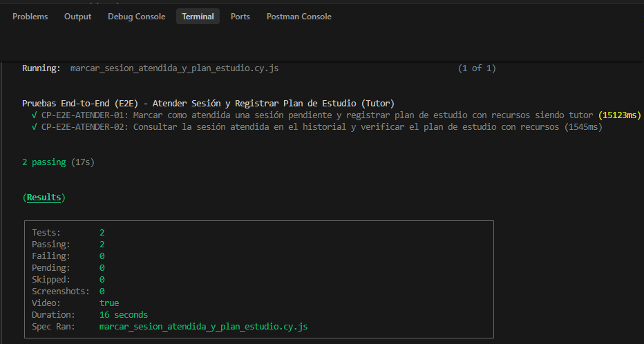
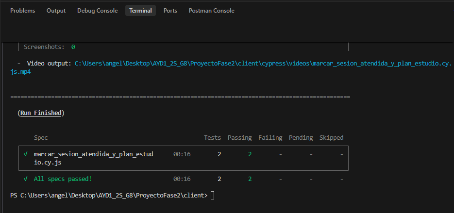
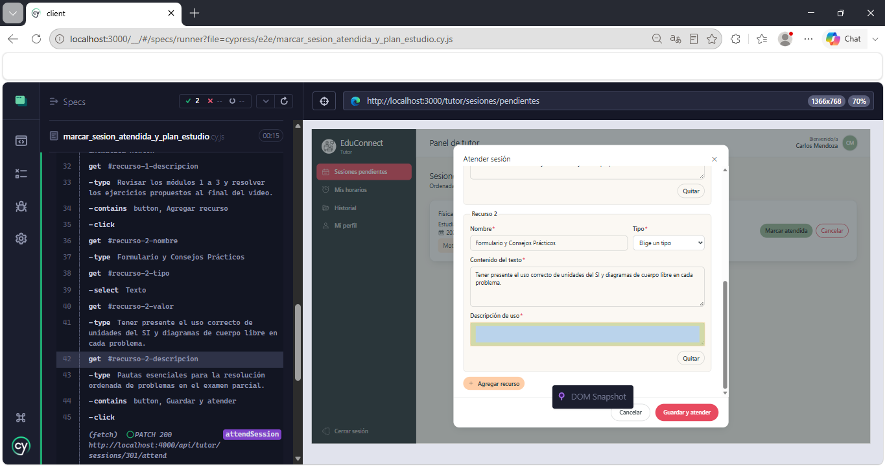
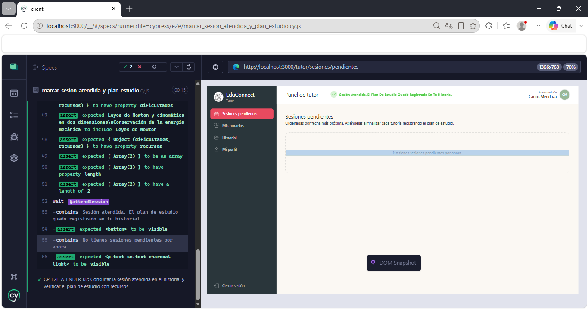
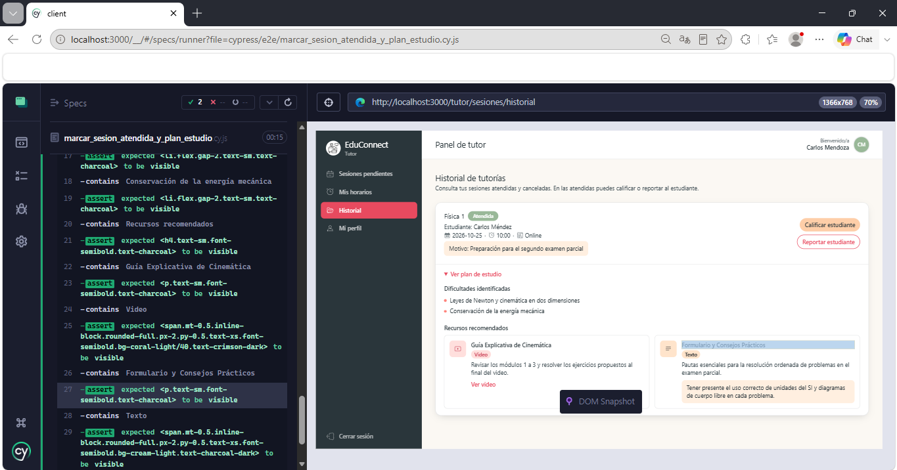

# Documentación de Pruebas End-to-End (E2E) - Atender Sesión y Mandar Plan de Estudio (Tutor)

Este documento describe la especificación técnica, diseño de casos de prueba, comandos de ejecución y resultados de la suite automatizada End-to-End (E2E) desarrollada con **Cypress** para validar la funcionalidad de:

> **"Marcar como atendida una sesión y mandar un plan de estudio con recursos siendo tutor."**

---

## 1. Información General del Entorno de Pruebas

- **Herramienta de automatización:** Cypress v14.5.4
- **Navegador de pruebas:** Electron (Headless) / Google Chrome
- **URL Base de la aplicación frontend:** `http://localhost:3000`
- **URL Base del API backend:** `http://localhost:4000/api`
- **Ubicación del archivo de prueba:** `ProyectoFase2/client/cypress/e2e/marcar_sesion_atendida_y_plan_estudio.cy.js`
- **Configuración de Cypress:** `ProyectoFase2/client/cypress.config.cjs`

---

## 2. Ficha Técnica de Casos de Prueba E2E

| No. | ID Caso de Prueba | Funcionalidad Evaluada | Rol Evaluado | Precondición | Pasos Ejecutados | Resultado Esperado | Resultado Obtenido | Estado |
| :--- | :--- | :--- | :--- | :--- | :--- | :--- | :--- | :--- |
| **1** | `CP-E2E-ATENDER-01` | **Marcar como atendida una sesión pendiente y registrar plan de estudio con recursos** | Tutor | Usuario tutor autenticado en la plataforma con una sesión pendiente asignada con un estudiante. | 1. Acceder a la vista de sesiones pendientes (`/tutor/sesiones/pendientes`).<br>2. Localizar la tarjeta de la sesión con Carlos Méndez en Física 1 y presionar "Marcar atendida".<br>3. En el modal interactivo, ingresar en el área de dificultades identificadas: `"Leyes de Newton y cinemática en dos dimensiones\nConservación de la energía mecánica"`.<br>4. Hacer clic en "Agregar recurso" para añadir el primer recurso (tipo Video) con nombre `"Guía Explicativa de Cinemática"`, URL `"https://educonnect.ejemplo.com/videos/cinematica-newton"` y descripción de uso.<br>5. Hacer clic de nuevo en "Agregar recurso" para añadir un segundo recurso (tipo Texto) con nombre `"Formulario y Consejos Prácticos"`, contenido de texto y descripción.<br>6. Presionar el botón "Guardar y atender".<br>7. Validar el envío de la petición HTTP PATCH al backend con las dificultades y los dos recursos configurados. | El sistema valida que los campos requeridos estén completos, envía la solicitud de atención de tutoría con el plan de estudio al servidor, despliega notificación toast de confirmación y retira la sesión de la lista de pendientes. | Modal desplegado correctamente, formulario de plan completado con dificultades y recursos estructurados, petición PATCH validada con código HTTP 200, toast `"Sesión atendida. El plan de estudio quedó registrado en tu historial."` visible y lista actualizada. | **EXITOSO (PASS)** |
| **2** | `CP-E2E-ATENDER-02` | **Consultar la sesión atendida en el historial y verificar el plan de estudio con recursos** | Tutor | Tutor autenticado en la plataforma. Sesión previamente marcada como atendida disponible en el historial de tutorías. | 1. Acceder a la vista de historial de sesiones del tutor (`/tutor/sesiones/historial`).<br>2. Validar que la sesión con el estudiante se liste con el estado `"Atendida"`.<br>3. Desplegar la sección de detalles haciendo clic en `"Ver plan de estudio"`.<br>4. Validar la petición al endpoint de detalle de la sesión (`GET /api/tutor/sessions/301/detail`).<br>5. Verificar la visualización de las dificultades identificadas previamente registradas.<br>6. Verificar la presentación de los recursos recomendados clasificados por tipo (Video y Texto) junto con sus nombres, contenidos y descripciones. | El historial muestra la sesión concluida con su estado respectivo. Al desplegar los detalles, el sistema recupera y renderiza el plan de estudio completo, mostrando con fidelidad las dificultades y recursos pedagógicos asignados al estudiante. | Sesión visualizada en estado Atendida, detalle del plan cargado bajo demanda, dificultades y recursos desplegados con sus etiquetas de tipo e instrucciones de estudio. | **EXITOSO (PASS)** |

---

## 3. Comandos de Ejecución

### Prerrequisito: Levantar el Entorno Local

Asegurarse de que los servicios se encuentren arriba con Docker Compose:

```bash
cd ProyectoFase2
docker compose up --build
```

### Ejecución en Modo Headless (Línea de Comandos)

Para ejecutar únicamente la suite de marcar sesión atendida y plan de estudio:

```bash
cd ProyectoFase2/client
npx cypress run --spec "cypress/e2e/marcar_sesion_atendida_y_plan_estudio.cy.js"
```

### Ejecución en Modo Interactivo con Interfaz Gráfica

Para abrir el explorador interactivo de Cypress y observar la prueba en tiempo real:

```bash
cd ProyectoFase2/client
npx cypress open
```

1. Seleccionar la opción **E2E Testing**.
2. Elegir navegador (Electron, Chrome o Edge).
3. Seleccionar `marcar_sesion_atendida_y_plan_estudio.cy.js` para iniciar la ejecución interactiva.

---

## 4. Evidencias de Ejecución en Consola

Salida real obtenida durante la ejecución automatizada de Cypress:

```text
====================================================================================================

  (Run Starting)

  ┌────────────────────────────────────────────────────────────────────────────────────────────────┐
  │ Cypress:        14.5.4                                                                         │
  │ Browser:        Electron 130 (headless)                                                        │
  │ Node Version:   v22.20.0 (C:\Program Files\nodejs\node.exe)                                    │
  │ Specs:          1 found (marcar_sesion_atendida_y_plan_estudio.cy.js)                          │
  │ Searched:       C:\Users\angel\Desktop\AYD1_2S_G8\ProyectoFase2\client\cypress\e2e\marcar_sesi │
  │                 on_atendida_y_plan_estudio.cy.js                                               │
  └────────────────────────────────────────────────────────────────────────────────────────────────┘


────────────────────────────────────────────────────────────────────────────────────────────────────
                                                                                                    
  Running:  marcar_sesion_atendida_y_plan_estudio.cy.js                                     (1 of 1)


  Pruebas End-to-End (E2E) - Atender Sesión y Registrar Plan de Estudio (Tutor)
    √ CP-E2E-ATENDER-01: Marcar como atendida una sesión pendiente y registrar plan de estudio con recursos siendo tutor (17541ms)
    √ CP-E2E-ATENDER-02: Consultar la sesión atendida en el historial y verificar el plan de estudio con recursos (1933ms)


  2 passing (20s)


  (Results)

  ┌────────────────────────────────────────────────────────────────────────────────────────────────┐
  │ Tests:        2                                                                                │
  │ Passing:      2                                                                                │
  │ Failing:      0                                                                                │
  │ Pending:      0                                                                                │
  │ Skipped:      0                                                                                │
  │ Screenshots:  0                                                                                │
  │ Video:        true                                                                             │
  │ Duration:     19 seconds                                                                       │
  │ Spec Ran:     marcar_sesion_atendida_y_plan_estudio.cy.js                                      │
  └────────────────────────────────────────────────────────────────────────────────────────────────┘


  (Video)

  -  Video output: C:\Users\angel\Desktop\AYD1_2S_G8\ProyectoFase2\client\cypress\videos\marcar_sesion_atendida_y_plan_estudio.cy.js.mp4


====================================================================================================

  (Run Finished)


       Spec                                              Tests  Passing  Failing  Pending  Skipped  
  ┌────────────────────────────────────────────────────────────────────────────────────────────────┐
  │ √  marcar_sesion_atendida_y_plan_estud      00:19        2        2        -        -        - │
  │    io.cy.js                                                                                    │
  └────────────────────────────────────────────────────────────────────────────────────────────────┘
    √  All specs passed!                        00:19        2        2        -        -        -  
```

---

## 5. Evidencias




