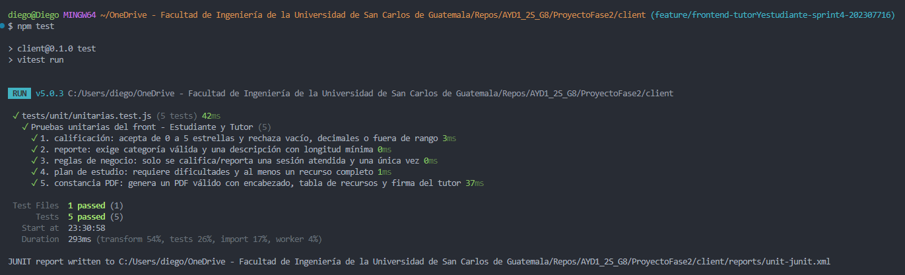

# Pruebas del Sprint 4: qué hace cada una

Este documento explica qué verifica cada prueba automatizada del front (HU-047 y HU-048).
Todo corre **sin backend**: las pantallas usan datos simulados que viven en el navegador (`localStorage`).

| Tipo                | Herramienta | Archivo                     | Pruebas |
| ------------------- | ----------- | --------------------------- | ------- |
| Unitarias (HU-047)  | Vitest      | `tests/unit/hu047.test.js`  | 5       |
| End-to-End (HU-048) | Cypress     | `cypress/e2e/sprint4.cy.js` | 4       |

Comandos:

```bash
npm test          # pruebas unitarias (reporte JUnit en reports/unit-junit.xml)
npm run e2e       # levanta el front y corre Cypress (video en cypress/videos, capturas en cypress/screenshots)
```

---

## 1. Pruebas unitarias

Prueban **funciones puras** (sin abrir el navegador ni dibujar pantallas): se les da una entrada y se comprueba la salida.
Las reglas que verifican están en `src/lib/evaluaciones.js`, `src/lib/api/plan-estudio.js` y `src/lib/pdf/constancia.js`.

### Prueba 1: Calificación por estrellas (HU-033 / HU-036)

Función: `validarCalificacion`.

- Acepta **0** y **5** estrellas (el 0 es una puntuación válida).
- Rechaza `null`, `undefined`, `-1`, `6` y `3.5`, y en cada caso devuelve el error de `estrellas`.
- Con 4 estrellas y comentario vacío (solo espacios) la calificación **es válida**: para el estudiante el comentario es opcional.
- Con la opción `comentarioObligatorio` (caso del tutor), el mismo comentario vacío **devuelve error** en `comentario`.

### Prueba 2: Formulario de reporte (HU-034 / HU-037)

Función: `validarReporte`, con las categorías de reporte a tutor.

- Con categoría válida y descripción de al menos 20 caracteres: es válido.
- Categoría vacía: error en `categoria`.
- Categoría que no existe en la lista (`"inventada"`): error en `categoria`.
- Descripción corta (`"corto"`): error en `descripcion` por no llegar al mínimo.
- Descripción solo con espacios: error en `descripcion`.

### Prueba 3: Reglas de negocio de evaluación (HU-033 / 034 / 036 / 037)

Funciones: `puedeCalificar` y `puedeReportar`.

- Una sesión **atendida**, sin calificación y sin reporte, se puede calificar y reportar.
- Una sesión en estado `activa`, `pendiente`, `cancelada_tutor` o `cancelada-estudiante` **no** se puede calificar ni reportar.
- Una sesión atendida que **ya tiene calificación** no se puede calificar de nuevo.
- Una sesión atendida que **ya fue reportada** no se puede reportar de nuevo.

### Prueba 4: Plan de estudio del tutor (HU-035)

Función: `validarPlanEstudio`.

- Sin dificultades y sin recursos: no es válido.
- Con dificultades pero sin recursos: error en `recursos`.
- Con un recurso vacío: error en los tres campos del recurso (`nombre`, `tipo`, `descripcion`).
- Con dificultades y un recurso completo: es válido.

### Prueba 5: Constancia PDF (HU-032)

Función: `construirConstanciaPdf`. Genera un PDF de ejemplo y revisa su contenido:

- Es un PDF bien formado: empieza con `%PDF-1.4` y termina con `%%EOF`.
- **Encabezado:** contiene "EduConnect", "Fecha de emisión" y el teléfono de contacto.
- **Cuerpo:** contiene el nombre del recurso recomendado y el título de la columna "Descripción de uso".
- **Pie:** contiene "Firma digital del tutor", el nombre del tutor y su número de identificación.

### Matriz de cobertura

| #   | Historia              | Qué protege                                                       |
| --- | --------------------- | ----------------------------------------------------------------- |
| 1   | HU-033, HU-036        | Puntuación 0 a 5 y comentario opcional u obligatorio según el rol |
| 2   | HU-034, HU-037        | Categoría obligatoria y descripción mínima en reportes            |
| 3   | HU-033, 034, 036, 037 | Solo sesiones atendidas y una única calificación o reporte        |
| 4   | HU-035                | Plan de estudio completo antes de atender una sesión              |
| 5   | HU-032                | Estructura y contenido de la constancia PDF                       |

### Qué no cubren

- No dibujan componentes ni simulan clics: eso lo hacen las pruebas E2E.
- No prueban el backend. Los criterios de HU-047 sobre traslapes de horario, encriptación de contraseñas y validación de tokens corresponden a pruebas del backend.

---

## 2. Pruebas End-to-End (Cypress)

Abren la aplicación en un navegador real y la usan como lo haría una persona: entran con un rol, hacen clic, escriben,
cambian de rol y comprueban lo que aparece en pantalla. Verifican que las piezas funcionen **juntas**.

**Cómo entran al sistema.** El comando `cy.entrarComo(rol)` (en `cypress/support/e2e.js`) deja un usuario demo en
`localStorage` antes de cargar la página y abre la pantalla inicial del rol (no usa el botón del login). Al cambiar de rol
dentro de una prueba, los datos simulados se conservan, por eso lo que hace el tutor lo ve después el estudiante y luego el administrador.
Cypress limpia `localStorage` entre pruebas, así que cada una parte de los mismos datos de ejemplo.

### Prueba 1: Atención de sesión con plan de estudio y descarga de constancia (HU-035 → HU-031 / HU-032)

1. **Tutor**: abre sus sesiones pendientes y marca como atendida la de "Cálculo Integral".
2. En el formulario escribe las dificultades, agrega un recurso (nombre, tipo Texto, contenido y descripción) y pulsa "Guardar y atender".
3. Comprueba que "Cálculo Integral" **desaparece de pendientes**.
4. **Estudiante**: abre "Plan de estudio" y comprueba que se ven la materia, las dificultades y el recurso que registró el tutor.
5. Pulsa el botón de descargar constancia y lee el archivo `cypress/downloads/educonnect-plan-5.pdf`. Comprueba que es un PDF y que contiene "EduConnect", "Firma digital del tutor", "Carlos Mendoza" y el nombre del recurso.

### Prueba 2: El estudiante califica y reporta al tutor (HU-033 / HU-034)

1. **Estudiante**: en el historial, abre "Calificar tutor" en "Cálculo Diferencial".
2. Intenta enviar sin elegir estrellas y comprueba el error "Elige una puntuación de 0 a 5 estrellas."
3. Elige 4 estrellas, envía, y la tarjeta pasa a mostrar "Tu calificación".
4. Abre "Reportar tutor" y envía vacío: error "Elige una categoría."
5. Elige "Negligencia académica" con una descripción muy corta: error "Explica con más detalle".
6. Escribe una descripción suficiente, envía, y la tarjeta muestra "Reporte enviado".
7. **Administrador**: en Denuncias aparece una fila de "Carlos Mendoza" con categoría "Negligencia académica", denunciante "Ana Lucía Morales" y estado "Pendiente".

### Prueba 3: El tutor califica y reporta al estudiante (HU-036 / HU-037)

1. **Tutor**: en el historial, abre "Calificar estudiante" en "Estadística".
2. Elige 3 estrellas y envía sin comentario: error "Escribe un comentario explicando tu evaluación." (para el tutor el comentario es obligatorio).
3. Escribe el comentario, envía, y la tarjeta muestra "Tu calificación".
4. Abre "Reportar estudiante", elige "Agresión verbal / física", escribe la descripción y envía. La tarjeta muestra "Reporte enviado".
5. **Administrador**: en la pestaña "Denuncias contra Estudiantes" aparece la fila de "Agresión verbal / física" con "Diego Ramírez" (denunciado) y "Carlos Mendoza" (denunciante).

### Prueba 4: Reglas de negocio en el historial (HU-033 / 034 / 036 / 037)

Con el estudiante en su historial:

- "Álgebra Lineal" (cancelada) **no** muestra "Calificar tutor" ni "Reportar tutor".
- "Física 1" (ya calificada) muestra "Tu calificación" y **no** vuelve a ofrecer "Calificar tutor".
- "Química General" (ya reportada) muestra "Reporte enviado" y **no** vuelve a ofrecer "Reportar tutor".
- "Cálculo Integral" (sesión activa) **no aparece** en el historial, así que no se puede evaluar.

### Qué no cubren

- No usan backend. Los flujos de **registro con verificación por token** y **programación de tutoría sin traslape** (mencionados en HU-048) dependen del backend y no están en este conjunto.
- No prueban el botón "Modo demo" del login. Las pruebas entran directo con el usuario guardado para evitar que el clic se pierda antes de que React cargue.

---

## 3. Evidencia

- **Unitarias:** salida de `npm test`.
  
- **E2E:** video en `cypress/videos/sprint4.cy.js.mp4`.
  
