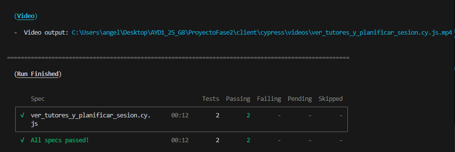
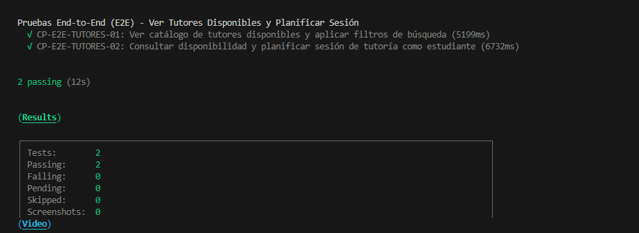
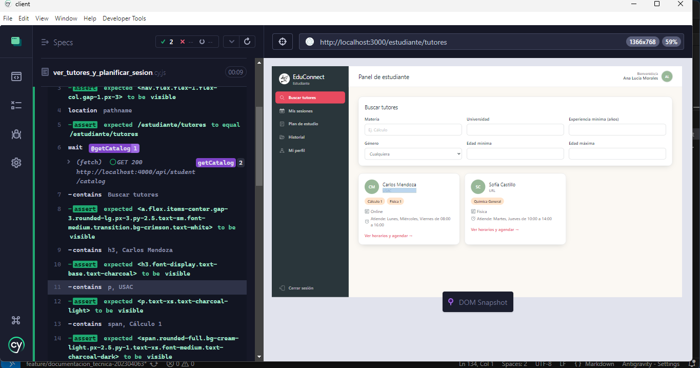
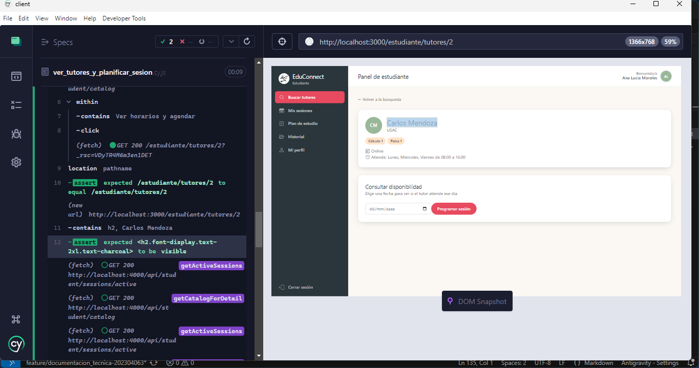
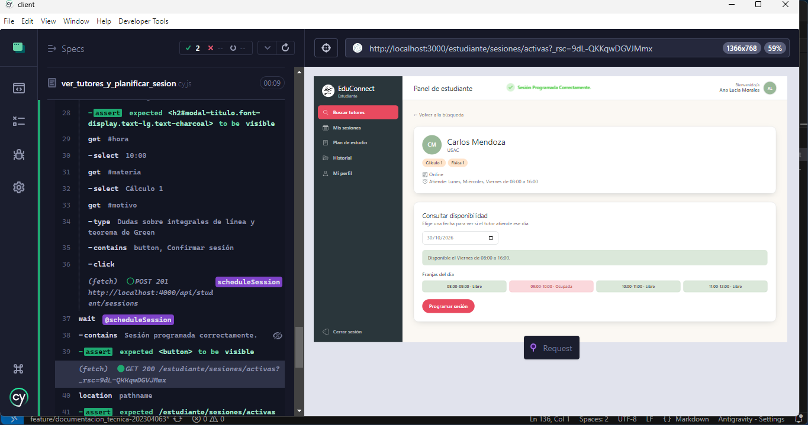

# Documentación de Pruebas End-to-End (E2E) - Ver Tutores Disponibles y Planificar Sesión

Este documento describe la especificación técnica, diseño de casos de prueba, comandos de ejecución y resultados de la suite automatizada End-to-End (E2E) desarrollada con **Cypress** para validar la funcionalidad de:

> **"Ver tutores disponibles y planificar sesión como estudiante."**

---

## 1. Información General del Entorno de Pruebas

- **Herramienta de automatización:** Cypress v14.5.4
- **Navegador de pruebas:** Electron (Headless) / Google Chrome
- **URL Base de la aplicación frontend:** `http://localhost:3000`
- **URL Base del API backend:** `http://localhost:4000/api`
- **Ubicación del archivo de prueba:** `ProyectoFase2/client/cypress/e2e/ver_tutores_y_planificar_sesion.cy.js`
- **Configuración de Cypress:** `ProyectoFase2/client/cypress.config.cjs`

---

## 2. Ficha Técnica de Casos de Prueba E2E

| No. | ID Caso de Prueba | Funcionalidad Evaluada | Rol Evaluado | Precondición | Pasos Ejecutados | Resultado Esperado | Resultado Obtenido | Estado |
| :--- | :--- | :--- | :--- | :--- | :--- | :--- | :--- | :--- |
| **1** | `CP-E2E-TUTORES-01` | **Ver catálogo de tutores disponibles y aplicar filtros de búsqueda** | Estudiante | Usuario estudiante autenticado en la plataforma. Catálogo de tutores activos disponible en el sistema. | 1. Ingresar a la sección de catálogo de tutores (`/estudiante/tutores`).<br>2. Validar que la interfaz liste los tutores disponibles con su información básica (nombre, universidad de procedencia y especialidades impartidas).<br>3. Aplicar filtro de búsqueda por materia ingresando `"Cálculo"` en el campo de texto correspondiente.<br>4. Comprobar que la vista filtre en tiempo real únicamente al tutor que imparte dicha asignatura.<br>5. Limpiar el filtro de búsqueda y verificar que se restablezca la totalidad de tutores disponibles. | El catálogo carga dinámicamente. Al filtrar por una asignatura específica, la vista se actualiza inmediatamente mostrando solo los tutores coincidentes. Al limpiar el filtro, la lista completa vuelve a estar disponible. | Catálogo renderizado correctamente con tarjetas de tutores, filtro de asignatura evaluado en caliente excluyendo tutores no coincidentes, y restauración completa al vaciar el campo. | **EXITOSO (PASS)** |
| **2** | `CP-E2E-TUTORES-02` | **Consultar disponibilidad y planificar sesión de tutoría como estudiante** | Estudiante | Usuario estudiante autenticado en la plataforma. Tutor seleccionado con días de atención y franjas horarias configuradas. | 1. En la vista de tutores disponibles, hacer clic en "Ver horarios y agendar" en el perfil de Carlos Mendoza.<br>2. Validar redirección a la vista de detalle y disponibilidad (`/estudiante/tutores/2`).<br>3. Ingresar una fecha de atención válida dentro del horario del tutor (`2026-10-30`, Viernes).<br>4. Validar la respuesta del horario general (`08:00 a 16:00`) y visualización de las franjas horarias (libres y ocupadas).<br>5. Presionar el botón "Programar sesión" para abrir el modal interactivo de reserva.<br>6. Seleccionar hora de inicio `"10:00"`, materia `"Cálculo 1"`, ingresar motivo `"Dudas sobre integrales de línea y teorema de Green"` y pulsar "Confirmar sesión".<br>7. Validar envío de la petición HTTP POST, confirmación en toast y redirección automática a Mis Sesiones (`/estudiante/sesiones/activas`). | La consulta de disponibilidad valida los días laborales del tutor y muestra las franjas horarias libres. El modal de reserva permite seleccionar horarios disponibles y registrar la sesión con éxito, redirigiendo al estudiante a su panel de sesiones activas. | Disponibilidad consultada con éxito, franjas horarias desplegadas, modal validado con campos requeridos, petición POST respondida con código HTTP 201 y navegación automática a `/estudiante/sesiones/activas`. | **EXITOSO (PASS)** |

---

## 3. Comandos de Ejecución

### Prerrequisito: Levantar el Entorno Local

Asegurarse de que los servicios se encuentren arriba con Docker Compose:

```bash
cd ProyectoFase2
docker compose up --build
```

### Ejecución en Modo Headless (Línea de Comandos)

Para ejecutar únicamente la suite de ver tutores y planificar sesión:

```bash
cd ProyectoFase2/client
npx cypress run --spec "cypress/e2e/ver_tutores_y_planificar_sesion.cy.js"
```

### Ejecución en Modo Interactivo con Interfaz Gráfica

Para abrir el explorador interactivo de Cypress y observar la prueba en tiempo real:

```bash
cd ProyectoFase2/client
npx cypress open
```

1. Seleccionar **E2E Testing**.
2. Elegir navegador (Electron, Chrome o Edge).
3. Seleccionar `ver_tutores_y_planificar_sesion.cy.js` para iniciar la ejecución interactiva.

---

## 4. Evidencias de Ejecución en Consola

Salida real obtenida durante la ejecución automatizada de Cypress:

```text
====================================================================================================

  (Run Starting)

  ┌────────────────────────────────────────────────────────────────────────────────────────────────┐
  │ Cypress:        14.5.4                                                                         │
  │ Browser:        Electron 130 (headless)                                                        │
  │ Node Version:   v22.20.0 (C:\Program Files\nodejs\node.exe)                                    │
  │ Specs:          1 found (ver_tutores_y_planificar_sesion.cy.js)                                │
  │ Searched:       C:\Users\angel\Desktop\AYD1_2S_G8\ProyectoFase2\client\cypress\e2e\ver_tutores │
  │                 _y_planificar_sesion.cy.js                                                     │
  └────────────────────────────────────────────────────────────────────────────────────────────────┘


────────────────────────────────────────────────────────────────────────────────────────────────────
                                                                                                    
  Running:  ver_tutores_y_planificar_sesion.cy.js                                           (1 of 1)


  Pruebas End-to-End (E2E) - Ver Tutores Disponibles y Planificar Sesión
    √ CP-E2E-TUTORES-01: Ver catálogo de tutores disponibles y aplicar filtros de búsqueda (3177ms)
    √ CP-E2E-TUTORES-02: Consultar disponibilidad y planificar sesión de tutoría como estudiante (4821ms)


  2 passing (8s)


  (Results)

  ┌────────────────────────────────────────────────────────────────────────────────────────────────┐
  │ Tests:        2                                                                                │
  │ Passing:      2                                                                                │
  │ Failing:      0                                                                                │
  │ Pending:      0                                                                                │
  │ Skipped:      0                                                                                │
  │ Screenshots:  0                                                                                │
  │ Video:        true                                                                             │
  │ Duration:     8 seconds                                                                        │
  │ Spec Ran:     ver_tutores_y_planificar_sesion.cy.js                                            │
  └────────────────────────────────────────────────────────────────────────────────────────────────┘


  (Video)

  -  Video output: C:\Users\angel\Desktop\AYD1_2S_G8\ProyectoFase2\client\cypress\videos\ver_tutores_y_planificar_sesion.cy.js.mp4


====================================================================================================

  (Run Finished)


       Spec                                              Tests  Passing  Failing  Pending  Skipped  
  ┌────────────────────────────────────────────────────────────────────────────────────────────────┐
  │ √  ver_tutores_y_planificar_sesion.cy.      00:08        2        2        -        -        - │
  │    js                                                                                          │
  └────────────────────────────────────────────────────────────────────────────────────────────────┘
    √  All specs passed!                        00:08        2        2        -        -        -  
```

---

# 5. Evidencias 




