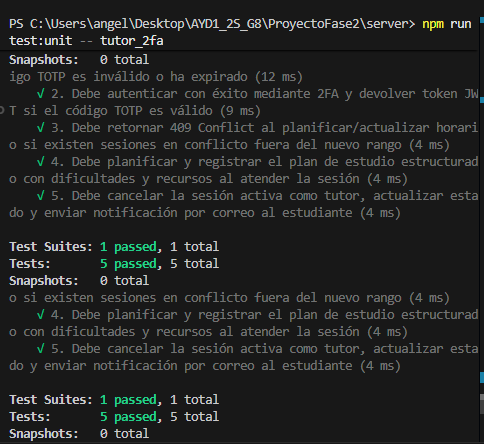
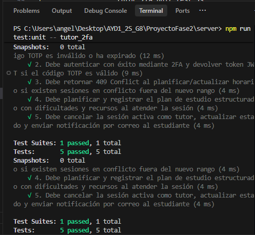
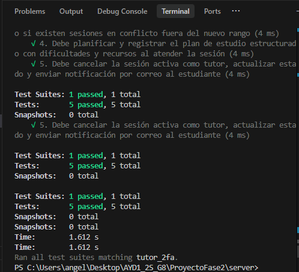
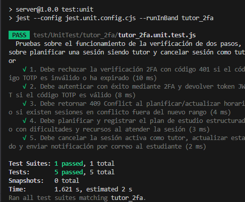

# Documentación de Pruebas Unitarias del Backend - Verificación 2FA y Gestión de Sesiones del Tutor

Este documento detalla la especificación técnica, diseño, cobertura y resultados de la suite de 5 pruebas unitarias automatizadas desarrolladas para el backend bajo la descripción:

> **"Pruebas sobre el funcionamiento de la verificación de dos pasos, sobre planificar una sesión siendo tutor y cancelar sesión como tutor."**

---

## 1. Información General de la Suite

- **Framework de pruebas:** Jest v30.5.2
- **Entorno de ejecución:** Node.js v22 (Backend)
- **Ubicación del código ejecutable:** `ProyectoFase2/server/test/UnitTest/tutor_2fa/tutor_2fa.unit.test.js`
- **Ubicación en documentación:** `ProyectoFase2/documentacion/pruebas/pruebas unitarias 2fa y tutor/`
- **Configuración de Jest:** `ProyectoFase2/server/jest.unit.config.cjs`
- **Estrategia de aislamiento:** Mocks completos de conexión a base de datos PostgreSQL, servicio de autenticación TOTP (otplib), modelos de datos y servicio de envío de correos, garantizando pruebas puras, deterministas y de rápida ejecución.

---

## 2. Ficha Técnica de los 5 Casos de Prueba Unitarios

| No. | ID Caso de Prueba | Funcionalidad Evaluada | Controlador / Componente Evaluado | Entrada / Precondición | Resultado Esperado | Resultado Obtenido | Estado |
| :--- | :--- | :--- | :--- | :--- | :--- | :--- | :--- |
| **1** | `CP-UNIT-2FA-01` | **Verificación 2FA con código erróneo o expirado** | `verify2fa` (`src/controllers/admin.js`) | `adminId: 1`, `token: "000000"`, validación TOTP devuelve `false`. | Código HTTP `401 Unauthorized` con mensaje `"Código de verificación inválido o expirado."`. | Retorna `401` y cuerpo de error esperado sin generar sesión ni token. | **EXITOSO (PASS)** |
| **2** | `CP-UNIT-2FA-02` | **Autenticación 2FA exitosa y generación de JWT** | `verify2fa` (`src/controllers/admin.js`) | `adminId: 1`, `token: "123456"`, validación TOTP devuelve `true`. | Código HTTP `200 OK`, generación de token JWT firmado y usuario con `two_factor_enable: true`. | Retorna `200`, `message: "Autenticación exitosa"` y token JWT válido. | **EXITOSO (PASS)** |
| **3** | `CP-UNIT-TUTOR-01` | **Planificar horario de atención del tutor con detección de conflictos** | `upsertSchedule` (`src/controllers/tutor.controller.js`) | `dias: ["Lunes", "Miercoles"]`, `startTime: "08:00"`, `endTime: "12:00"`. Existen sesiones activas fuera de dicho rango. | Código HTTP `409 Conflict`, mensaje de advertencia y listado de sesiones en conflicto, impidiendo la actualización inconsistente. | Retorna `409`, bloquea la ejecución de `upsert` y devuelve el arreglo de conflictos. | **EXITOSO (PASS)** |
| **4** | `CP-UNIT-TUTOR-02` | **Planificar sesión siendo tutor (Registro de plan de estudio estructurado)** | `attendSession` (`src/controllers/tutor.controller.js`) | Sesión activa con ID `55`, dificultades pedagógicas válidas y recursos didácticos estructurados (Texto, Video). | Código HTTP `200 OK`, invocación a `sessionModel.markAttended` con dificultades y recursos, retornando la sesión con estado `"Atendida"`. | Retorna `200`, `"Sesión atendida exitosamente"` y estructura completa del plan de estudio registrado. | **EXITOSO (PASS)** |
| **5** | `CP-UNIT-TUTOR-03` | **Cancelar sesión como tutor con notificación por correo al estudiante** | `cancelSession` (`src/controllers/tutor.controller.js`) | Sesión activa con ID `77` asociada al tutor autenticado y con correo de estudiante registrado. | Código HTTP `200 OK`, cambio de estado a `"Cancelada_Tutor"`, invocación al servicio de correo `sendCancellationEmail` con destinatario y fecha/hora, y respuesta con `emailSent: true`. | Retorna `200`, `"Sesión cancelada exitosamente"`, `emailSent: true` y envío de correo verificado. | **EXITOSO (PASS)** |

---

## 3. Comandos de Ejecución en el Backend

Todas las pruebas deben ejecutarse situándose en el directorio del servidor:

```bash
cd ProyectoFase2/server
```

### Ejecutar únicamente esta suite de 5 pruebas unitarias:

```bash
npm run test:unit -- tutor_2fa
```

*(O de forma directa utilizando el binario de Jest)*:

```bash
npx jest --config jest.unit.config.cjs --runInBand tutor_2fa
```

### Ejecutar todas las pruebas unitarias del backend (Suite completa):

```bash
npm run test:unit
```

---

## 4. Evidencias de Resultados de Ejecución

Salida real obtenida en consola al ejecutar la suite:

```text
> server@1.0.0 test:unit
> jest --config jest.unit.config.cjs --runInBand tutor_2fa

PASS test/UnitTest/tutor_2fa/tutor_2fa.unit.test.js
  Pruebas sobre el funcionamiento de la verificación de dos pasos, sobre planificar una sesión siendo tutor y cancelar sesión como tutor
    √ 1. Debe rechazar la verificación 2FA con código 401 si el código TOTP es inválido o ha expirado (14 ms)
    √ 2. Debe autenticar con éxito mediante 2FA y devolver token JWT si el código TOTP es válido (8 ms)
    √ 3. Debe retornar 409 Conflict al planificar/actualizar horario si existen sesiones en conflicto fuera del nuevo rango (4 ms)
    √ 4. Debe planificar y registrar el plan de estudio estructurado con dificultades y recursos al atender la sesión (4 ms)
    √ 5. Debe cancelar la sesión activa como tutor, actualizar estado y enviar notificación por correo al estudiante (3 ms)

Test Suites: 1 passed, 1 total
Tests:       5 passed, 5 total
Snapshots:   0 total
Time:        1.875 s
Ran all test suites matching tutor_2fa.
```

---

## 5. Estructura de Archivos del Proyecto

```text
ProyectoFase2/
├── server/
│   ├── jest.unit.config.cjs
│   ├── package.json
│   ├── src/
│   │   └── controllers/
│   │       ├── admin.js             (verify2fa)
│   │       └── tutor.controller.js  (upsertSchedule, attendSession, cancelSession)
│   └── test/
│       └── UnitTest/
│           └── tutor_2fa/
│               └── tutor_2fa.unit.test.js
└── documentacion/
    └── pruebas/
        ├── README.md
        └── pruebas unitarias 2fa y tutor/
            ├── README.md
            └── tutor_2fa.unit.test.js
```


### Evidencias



